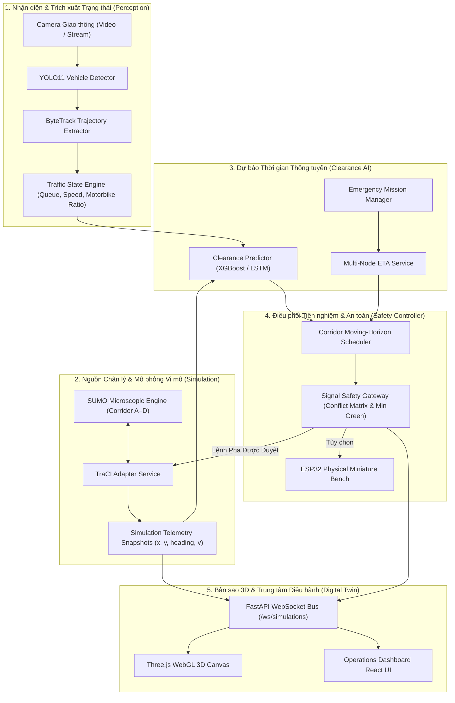

<div align="center">

# 🚦 ClearWay AI
### 3D Digital Twin • Multi-Intersection Pre-clearance • Traffic Simulation Platform
**Hệ thống Bản sao Kỹ thuật số 3D & Điều phối Tiên nghiệm Đa nút Giao thông Thông minh cho Hành lang Cứu hộ Khẩn cấp**

[](https://github.com/NguyenTriBaoThang/ClearWayAI/actions)
[](LICENSE)
[](pyproject.toml)
[](package.json)
[](docs/PROJECT_STATUS.md)

[**📖 Technical Documentation Website**](https://nguyentribaothang.github.io/ClearWayAI/) | [**📋 60-Task Roadmap**](docs/TASK_BOARD.md) | [**🏛️ System Architecture**](docs/ARCHITECTURE.md) | [**🛡️ Safety Policy**](SECURITY.md)

</div>

---

## 📌 Executive Summary (Tóm tắt Dự án)

**ClearWayAI** là nền tảng bản sao kỹ thuật số 3D (3D Digital Twin) kết hợp mô phỏng giao thông vi mô (microscopic traffic simulation) và trí tuệ nhân tạo (AI/ML) nhằm giải quyết bài toán: **Giải tỏa trước (Pre-clearance) hành lang cho phương tiện ưu tiên (xe cấp cứu, xe cứu hỏa) qua chuỗi nhiều nút giao thông liên tiếp mà không gây tắc nghẽn thứ cấp (secondary spillback) cho các phương tiện dân sự khác.**

Hệ thống kết hợp 5 trụ cột công nghệ:
1. **WebGL 3D Digital Twin tương tác thật:** Dựng giao lộ phối cảnh isometric bằng Three.js / React Three Fiber, ánh sáng, phân làn, xe cộ chuyển động và mũi tên hướng dẫn động.
2. **Mô phỏng vi mô Eclipse SUMO & TraCI:** Tái hiện luồng giao thông hỗn hợp đặc thù Việt Nam (tỷ lệ xe máy cao 60%–80%) với sublane model và hành vi nhường đường có kiểm soát.
3. **Mô hình AI dự báo Clearance Time:** Kết hợp baseline dạng bảng (XGBoost) và chuỗi thời gian (LSTM/GRU) để dự báo chính xác thời gian cần thiết để giải phóng hàng chờ.
4. **Bộ điều khiển an toàn độc lập (Signal Safety Gateway):** Bộ lọc toán học tuyệt đối ngăn chặn xung đột pha (conflicting greens), bảo vệ khoảng thời gian đèn vàng/đỏ toàn phần (yellow/all-red) và thời gian cho người đi bộ.
5. **Dashboard điều hành trung tâm:** Cung cấp bảng pha đèn thời gian thực, biểu đồ hàng chờ thích ứng, bản đồ mạng lưới cảm biến IoT và nhật ký giải trình quyết định AI.

---

## 🎯 Thiết kế Giao diện Tham chiếu (UI Reference Target)

> [!NOTE]
> **MINH BẠCH VỀ NGUỒN GỐC HÌNH ẢNH:**  
> Ảnh bên dưới là **mục tiêu thiết kế và trải nghiệm giao diện** được cung cấp làm chuẩn nghiệm thu bố cục, màu sắc và các panel thông tin. **ĐÂY KHÔNG PHẢI LÀ ẢNH CHỤP PHẦN MỀM ĐÃ CHẠY HOÀN TẤT.**  
> Trong ClearWayAI, khu vực trung tâm là **WebGL Three.js Canvas thật có thể xoay và thao tác**, tuyệt đối không dán ảnh tĩnh làm lớp giao thông giả.

<div align="center">
  
  <p><em>Hình 1: Bản vẽ thiết kế tham chiếu (Design Blueprint Reference — 1254×1254 px)</em></p>
</div>

---

## ⚡ English Summary

**ClearWayAI** is an intelligent urban traffic digital twin and multi-intersection coordination platform engineered to expedite emergency vehicle dispatch through congested arterials while mitigating collateral delays for private traffic. By combining **Eclipse SUMO microscopic simulation**, **fine-tuned YOLO + ByteTrack perception**, **temporal clearance prediction (XGBoost & LSTM)**, and a **deterministic Signal Safety Gateway**, ClearWayAI replaces reactive local preemption with predictive moving-horizon corridor clearing.

---

## 🏗️ Kiến trúc Hệ thống (System Architecture)



---

## 💻 Tech Stack

| Tầng công nghệ | Công nghệ sử dụng | Mục đích triển khai |
| :--- | :--- | :--- |
| **3D Graphics** | Three.js, React Three Fiber, WebGL | Dựng Digital Twin 3D tương tác, instancing xe cộ, phối cảnh isometric |
| **Frontend Web** | React 18, Vite, TypeScript, Tailwind | Trung tâm điều hành Operations Dashboard, biểu đồ Recharts, responsive |
| **Backend API** | FastAPI, Uvicorn, Pydantic v2 | REST API endpoints, xử lý tác vụ bất đồng bộ, OpenAPI documentation |
| **Streaming** | WebSocket, JSONL Replay | Đồng bộ thời gian thực 10Hz giữa SUMO, Backend và Canvas 3D |
| **Traffic Sim** | Eclipse SUMO, TraCI, Python | Mô phỏng vi mô chuỗi 4 nút giao, luồng xe máy sublane, xe cứu thương |
| **Computer Vision** | YOLO11s, ByteTrack, OpenCV | Phát hiện phương tiện, bám quỹ đạo, ước lượng hàng chờ từ góc nhìn camera |
| **Machine Learning**| Scikit-learn, XGBoost, PyTorch (LSTM) | Huấn luyện mô hình hồi quy dự báo thời gian giải tỏa hàng chờ (Clearance) |
| **Safety Gateway** | Python Deterministic Gate | Khóa xung đột pha, duy trì thời gian chuyển pha vàng/đỏ và nhường người đi bộ |
| **Physical Model** | C++, Arduino Core, ESP32 | Mô hình đèn tín hiệu vật lý thu nhỏ 3–4 ngã tư cho kiểm thử phần cứng |
| **Container & CI** | Docker Compose, GitHub Actions | Đóng gói môi trường tái lập, deploy tự động docs lên GitHub Pages |

---

## 📂 Cấu trúc Thư mục Monorepo

```
ClearWayAI/
├── .github/
│   ├── workflows/          # GitHub Actions CI/CD & Docs Deployment
│   ├── ISSUE_TEMPLATE/     # Templates Issue (Feature, Bug, Experiment)
│   ├── PULL_REQUEST_TEMPLATE.md
│   ├── dependabot.yml      # Tự động hóa cập nhật dependencies
│   ├── release.yml         # Phân loại tự động Release Notes
│   └── CODEOWNERS          # Phân quyền phụ trách các thư mục
├── ai/
│   ├── detection/          # Fine-tuning YOLO11 nhận diện xe
│   ├── tracking/           # ByteTrack trích xuất quỹ đạo
│   └── clearance/          # Train XGBoost & LSTM dự báo clearance time
├── apps/
│   ├── api/                # FastAPI backend & WebSocket bus
│   └── web/                # React Vite TypeScript frontend & Three.js 3D Twin
├── assets/
│   ├── reference/          # Ảnh tham chiếu dashboard-target.png (1254x1254)
│   └── vehicles/           # Mô hình 3D xe máy, ô tô, bus, ambulance (GLB)
├── controller/             # Signal Safety Gateway & Moving-Horizon Scheduler
├── data/
│   ├── raw/                # Video thô (tuân thủ privacy blur)
│   ├── processed/          # Labels định dạng YOLO/COCO
│   └── seed/               # Demo fixtures (DEMO_FIXTURE)
├── docs/                   # Tài liệu kiến trúc, ADR, Task Board, Status
├── docs-site/              # Website tài liệu kỹ thuật GitHub Pages
├── hardware/               # Firmware ESP32, sơ đồ mạch đấu nối đèn LED
├── models/                 # Model registry & weights manifests
├── notebooks/              # Google Colab & Jupyter notebooks huấn luyện
├── packages/
│   └── shared/             # TypeScript schemas & shared types
├── scripts/                # Bootstrap scripts (PowerShell & Bash)
├── simulation/
│   ├── sumo/               # Mạng lưới đường synthetic (.net.xml)
│   ├── scenarios/          # Kịch bản tải giao thông (Free, Peak, Spillback)
│   └── traci/              # Bộ điều khiển TraCI & snapshot replay
├── tests/                  # Root smoke tests & E2E verification
├── docker-compose.yml      # Cấu hình container api, web, redis
├── Makefile                # Lệnh tắt cho Linux/macOS
├── pyproject.toml          # Quản lý dependencies Python
└── package.json            # Quản lý workspaces pnpm/npm
```

---

## 🚀 Hướng dẫn Cài đặt & Khởi chạy Nhanh (Quick Start)

### Yêu cầu Tiên quyết
- **Python:** 3.10 trở lên
- **Node.js:** 18 trở lên (khuyên dùng `pnpm` hoặc `npm`)
- **Docker:** (Tùy chọn) Docker & Docker Compose
- **Eclipse SUMO:** (Cần cho các task mô phỏng vi mô Phase C+)

### Cách 1: Khởi tạo Tự động (Khuyên dùng)

#### Trên Windows (PowerShell):
```powershell
# Chạy script bootstrap tự động kiểm tra môi trường và cài đặt dependencies
.\scripts\bootstrap.ps1
```

#### Trên Linux / macOS (Bash):
```bash
chmod +x ./scripts/bootstrap.sh
./scripts/bootstrap.sh
```

---

### Cách 2: Khởi chạy Thủ công Từng Dịch vụ

#### 1. Khởi động Backend API:
```bash
# Khởi chạy server FastAPI tại http://localhost:8000
python -m uvicorn apps.api.src.main:app --reload --host 0.0.0.0 --port 8000
```
- Swagger API Docs: `http://localhost:8000/docs`
- Health Endpoint: `http://localhost:8000/health`
- System Status: `http://localhost:8000/api/v1/system/status`

#### 2. Khởi động Frontend Web:
```bash
# Khởi chạy ứng dụng Web tại http://localhost:3000
pnpm --filter clearway-web dev
```

#### 3. Khởi động Website Tài liệu Kỹ thuật (Docs Site):
```bash
# Khởi chạy cổng tài liệu tại http://localhost:3001
pnpm --filter clearway-docs-site dev
```

---

### Cách 3: Chạy bằng Docker Compose

```bash
# Khởi động toàn bộ cụm container (API, Web, Redis)
docker-compose up -d

# Xem log các container
docker-compose logs -f

# Dừng cụm container
docker-compose down
```

---

## 🧪 Kiểm thử Tự động (Testing Suite)

```bash
# 1. Chạy toàn bộ unit tests & smoke tests Python
python -m pytest

# 2. Build và kiểm tra kiểu typecheck cho gói shared
pnpm --filter @clearway/shared build

# 3. Build kiểm tra ứng dụng Web và Three.js 3D Canvas
pnpm --filter clearway-web build

# 4. Build kiểm tra website tài liệu kỹ thuật
pnpm --filter clearway-docs-site build

# 5. Xác thực cấu hình Docker Compose
docker-compose config
```

---

## 🛡️ Cam kết An toàn & Ranh giới Dữ liệu (Safety & Governance)

1. **SIMULATION ONLY:** Mọi can thiệp đèn tín hiệu chỉ diễn ra trong môi trường mô phỏng SUMO hoặc sa bàn LED thử nghiệm cách ly.
2. **Không can thiệp hạ tầng công cộng:** Hệ thống không chứa mã nguồn, backdoor hoặc adapter kết nối trái phép đến tủ điều khiển đèn ngoài thực địa.
3. **Minh bạch nhãn nguồn gốc dữ liệu (Provenance):** Mọi chỉ số hiển thị trên giao diện và API đều mang nhãn minh bạch:
   - `DEMO_FIXTURE`: Dữ liệu mẫu phục vụ kiểm thử giao diện khi simulator chưa kết nối.
   - `SUMO_SIMULATED`: Dữ liệu động sinh ra từ bộ mô phỏng vi mô SUMO.
   - `OFFLINE_VIDEO`: Dữ liệu quan sát trích xuất từ video hợp pháp.
   - `SHADOW_ADVISORY`: Chế độ quan sát khuyến nghị, không can thiệp.
4. **Bảo vệ quyền riêng tư:** Toàn bộ video thực tế nếu được thu thập đều được tự động làm mờ biển số xe và khuôn mặt theo quy định tại `SECURITY.md`.

---

## 📜 Giấy phép & Tác giả (License & Authors)

- **Tác giả:** Nguyễn Tri Bão Thắng ([@NguyenTriBaoThang](https://github.com/NguyenTriBaoThang))
- **Giấy phép:** [MIT License](LICENSE) — Bạn được tự do sử dụng, chỉnh sửa và đóng góp cho mục đích nghiên cứu và phi thương mại.
