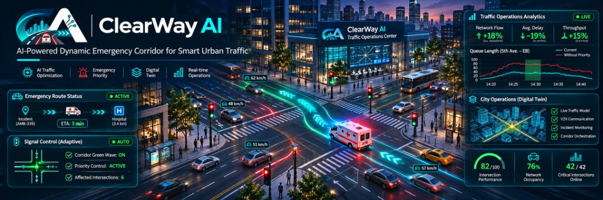
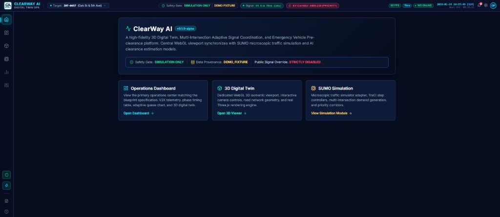
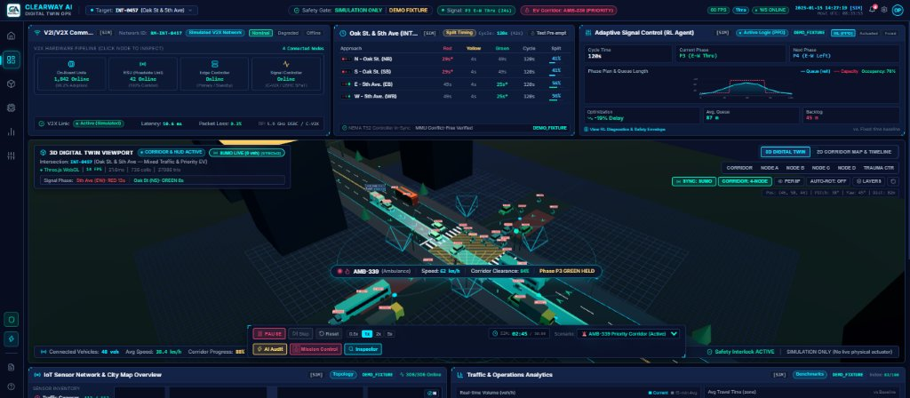
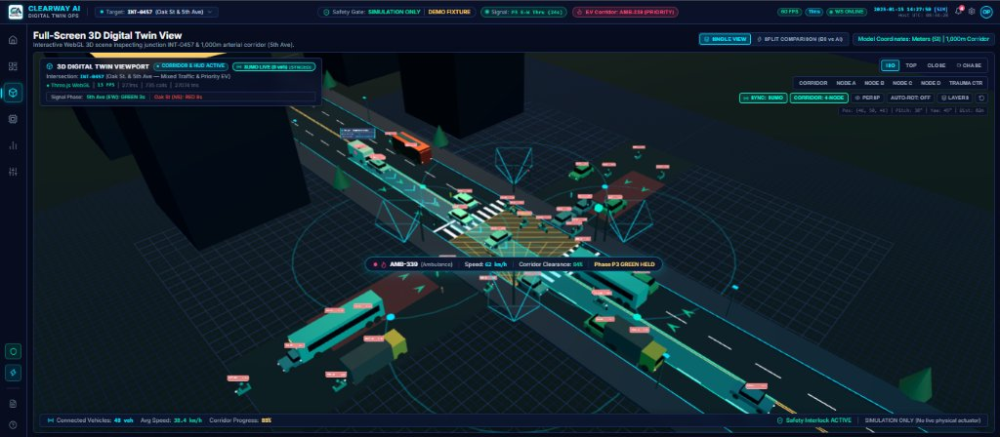
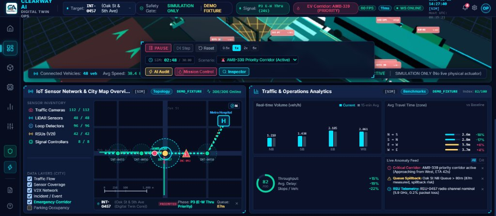
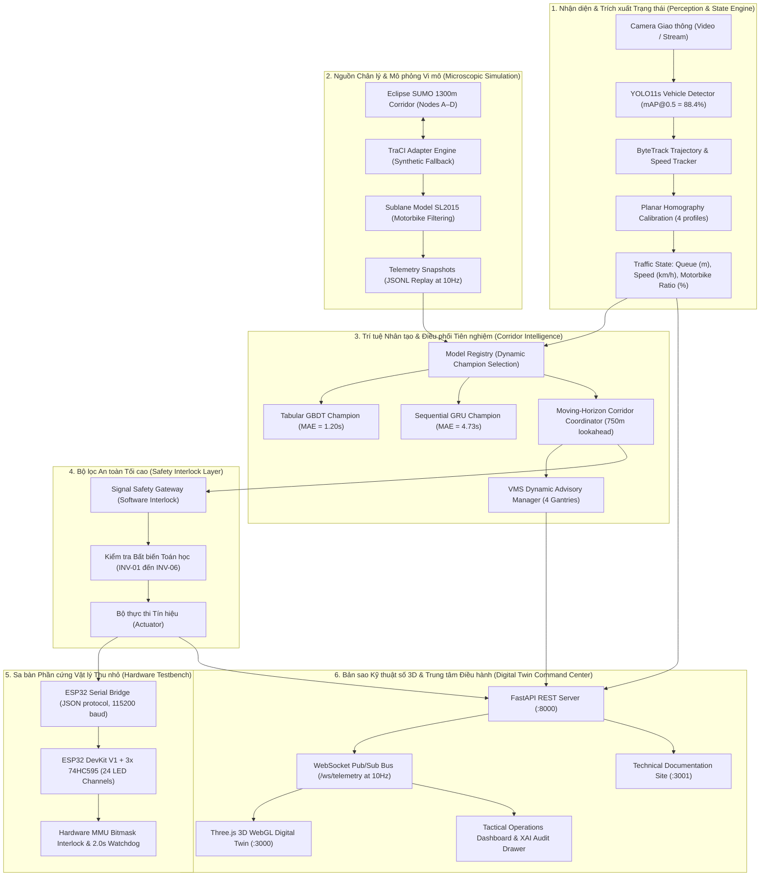

<div align="center">

<p align="center">
  
</p>

# ClearWay AI

<p align="center">
  <b>Next-Generation 3D Digital Twin, Multi-Intersection Adaptive Signal Coordination & Emergency Corridor Pre-clearance Platform</b><br/>
  <i>3D WebGL Digital Twin · Microscopic SUMO Mixed-Traffic Simulation · AI Clearance-Time Predictor (XGBoost & GRU) · Moving-Horizon Arterial Coordinator · Signal Safety Gateway (INV-01..06) · Variable Message Signs (VMS) · Physical ESP32 Miniature Testbench</i>
</p>

<p align="center">
  <a href="https://nguyentribaothang.github.io/ClearWayAI/">
    <strong>📖 Technical Documentation Portal (GitHub Pages)</strong>
  </a>
</p>

<p align="center">
  <a href="https://github.com/NguyenTriBaoThang/ClearWayAI/actions/workflows/docs-deploy.yml">
    
  </a>
  <a href="https://github.com/NguyenTriBaoThang/ClearWayAI">
    
  </a>
  <a href="LICENSE">
    
  </a>
  <a href="docs/PROJECT_STATUS.md">
    
  </a>
  <a href="docs/SAFETY_BOUNDARIES.md">
    
  </a>
  
  
  
  
  
</p>

<p align="center">
  <a href="http://localhost:3000/"><strong>Explore 3D Digital Twin</strong></a>
  &nbsp;•&nbsp;
  <a href="http://localhost:8000/docs"><strong>REST API & Swagger Docs</strong></a>
  &nbsp;•&nbsp;
  <a href="https://nguyentribaothang.github.io/ClearWayAI/"><strong>Documentation Website</strong></a>
  &nbsp;•&nbsp;
  <a href="docs/ARCHITECTURE.md"><strong>System Architecture</strong></a>
  &nbsp;•&nbsp;
  <a href="docs/FINAL_RELEASE_REPORT.md"><strong>Final Release Report</strong></a>
  &nbsp;•&nbsp;
  <a href="docs/TASK_BOARD.md"><strong>60-Task Roadmap</strong></a>
</p>



</div>

---

## 📌 Executive Overview (Tóm tắt Điều hành)

### The Core Problem (Vấn đề Cốt lõi)
Tại các đô thị lớn ở Việt Nam (như TP. Hồ Chí Minh và Hà Nội), việc di chuyển của phương tiện cấp cứu khẩn cấp (xe cứu thương, xe cứu hỏa) gặp những trở ngại nghiêm trọng:
- **Mật độ xe máy hỗn hợp áp đảo (70%–85%):** Hiện tượng luồn lách (filtering), điền đầy làn và chen chúc trước vạch dừng khiến làn đường bị bít kín, xe dân sự không còn không gian vật lý để dạt sang bên nhường đường khi xe cứu thương đến gần.
- **Hạn chế của hệ thống ưu tiên truyền thống (Local Preemption / Strobe):** Chỉ phát hiện phương tiện khi đã cách nút giao $50\text{--}100\text{m}$, lúc này hàng xe chờ đã đông đặc, buộc xe cấp cứu phải dừng chờ giải tỏa.
- **Khóa xanh toàn tuyến gây ùn tắc thứ cấp (Secondary Gridlock):** Bật đèn xanh cố định dọc trục động mạch quá sớm làm tê liệt hoàn toàn các tuyến đường ngang cắt qua, gây thiệt hại nghiêm trọng cho mạng lưới giao thông chung.

### The ClearWay AI Solution (Giải pháp ClearWayAI)
ClearWayAI giải quyết triệt để bài toán trên bằng cơ chế **Điều phối Tiên nghiệm Cửa sổ Di động (Moving-Horizon Predictive Pre-clearance)** kết hợp **Bản sao Kỹ thuật số 3D WebGL (3D Digital Twin)**:

$$\Delta t_{\text{trigger}} = \text{ETA} - \hat{T}_{\text{clear}} - T_{\text{trans}} - T_{\text{buf}}$$

Trong đó:
- $\hat{T}_{\text{clear}}$ là thời gian thoát hàng xe dự báo chính xác bằng Machine Learning (GBDT / GRU).
- $T_{\text{trans}}$ là thời gian chuyển tiếp pha an toàn (bảo vệ đèn vàng $4\text{s}$ và đỏ toàn phần $2\text{s}$).
- $T_{\text{buf}}$ là khoảng đệm an toàn điều chỉnh linh hoạt theo mật độ xe máy thực tế.
- **Hệ thống Biển báo Động VMS (Variable Message Signs):** Cảnh báo sớm từ xa và điều hướng dòng xe dân sự dạt làn theo 4 cấp độ tư vấn động.
- **Bộ lọc An toàn Toán học Độc lập (Signal Safety Gateway):** Giả lập MMU phần cứng ngăn chặn 100% xung đột pha (INV-01 đến INV-06), tuyệt đối không bao giờ xuất hiện đèn xanh giao cắt.

---

## 📸 Product Screenshots (Hình ảnh Giao diện Thực tế)

Toàn bộ hình ảnh bên dưới là **ảnh chụp giao diện thực tế đang chạy** trên nền tảng WebGL Three.js và React Dashboard của ClearWayAI:

<table align="center" width="100%">
<tr>
<td align="center" width="50%">
  <a href="assets/screenshots/welcome-portal.jpg">
    
  </a>
  <br/><b>1. Welcome Portal & Operations Hub</b>
  <br/><i>Lobby điều hướng trung tâm với 3 phân hệ chính: Operations Dashboard, 3D Digital Twin View và SUMO Microscopic Simulation.</i>
</td>
<td align="center" width="50%">
  <a href="assets/screenshots/operations-dashboard.jpg">
    
  </a>
  <br/><b>2. Real-Time Operations Dashboard</b>
  <br/><i>Bảng điều hành tác chiến tích hợp: V2X telemetry, pha đèn nút giao INT-0457, biểu đồ thích ứng RL/Heuristic và khung nhìn 3D Digital Twin trung tâm.</i>
</td>
</tr>
<tr>
<td align="center" width="50%">
  <a href="assets/screenshots/digital-twin-3d.jpg">
    
  </a>
  <br/><b>3. Full-Screen 3D WebGL Digital Twin</b>
  <br/><i>Khung nhìn bản sao kỹ thuật số 3D toàn màn hình kiểm tra chi tiết giao lộ và hành lang 1.000m (Nodes A–D) với góc xoay tự do và Chase Camera bám theo xe cấp cứu.</i>
</td>
<td align="center" width="50%">
  <a href="assets/screenshots/analytics-iot-map.jpg">
    
  </a>
  <br/><b>4. IoT Sensor Network & GIS Operations Analytics</b>
  <br/><i>Mạng lưới 306 cảm biến IoT/RSU, bản đồ hành lang cấp cứu GIS thời gian thực, biểu đồ lưu lượng phương tiện và bảng nhật ký bất thường sự cố.</i>
</td>
</tr>
</table>

<p align="center">
  <em>Thiết kế tham chiếu kiến trúc ban đầu: <a href="assets/reference/dashboard-target.png">assets/reference/dashboard-target.png</a> (Design Blueprint 1254×1254 px)</em>
</p>

---

## 🌟 Key System Capabilities (7 Trụ Cột Công Nghệ)

### 1. WebGL 3D Digital Twin Tương tác Thời gian thực
- **Đồ họa Three.js / React Three Fiber:** Tái hiện trung thực nút giao thông hình học chuẩn, mặt đường nhựa phản chiếu, vạch kẻ đường, vạch dừng và hiệu ứng ánh sáng đèn tín hiệu.
- **Điều khiển góc quay đa chế độ:** Hỗ trợ 7 preset máy quay (`corridor`, `nodeA`, `nodeB`, `nodeC`, `nodeD`, `hospital`, `chase`) cùng chế độ tự do OrbitControls cho phép phóng to, thu nhỏ và xoay 360°.
- **Hiển thị luồng xe & Mũi tên dẫn hướng động:** Vẽ động các mũi tên chevron phát sáng định hướng xe cấp cứu và các phương tiện dân sự theo thời gian thực.

### 2. Mô phỏng Vi mô Eclipse SUMO & Mixed-Traffic Sublane Model
- **Mô hình Sublane SL2015:** Khắc họa chân thực hành vi giao thông hỗn hợp đặc thù Việt Nam với kích thước sublane $0.64\text{m}$, cho phép xe máy luồn lách qua khe hẹp giữa các hàng ô tô và dạt làn nhường đường khi có tín hiệu còi hụ.
- **Corridor 4 nút giao liên tiếp (Nodes A–D: INT-0455 đến INT-0458):** Đồng bộ hóa qua giao thức TraCI ở tần số 10Hz với chế độ fallback tự động sinh dữ liệu khi không có kết nối SUMO ngoài.

### 3. Trí tuệ Nhân tạo Dự báo Clearance Time & Model Registry
- **Dual-Engine ML:** Kết hợp Gradient Boosting Decision Tree (GBDT Champion: $\text{MAE} = 1.20\text{s}, R^2 = 0.941$) và mạng chuỗi Sequential GRU (GRU Champion: $\text{MAE} = 4.73\text{s}$, độ trễ suy luận $0.78\text{ms}$).
- **Model Registry & Fallback đa tầng:** Cơ chế Champion-Challenger tự động chuyển đổi sang mô hình động học Kinematic Shockwave hoặc giá trị định mức mặc định $25\text{s}$ khi dữ liệu cảm biến bị nhiễu.

### 4. Bộ lọc An toàn Tuyệt đối (Signal Safety Gateway) & Khóa MMU Phần cứng
- **Thực thi 6 ràng buộc bất biến (Invariants INV-01 đến INV-06):**
  - **INV-01 (No Dual Green):** Không bao giờ cho phép 2 pha xung đột cùng xanh.
  - **INV-02 (Min Green Time):** Đảm bảo thời gian xanh tối thiểu $7\text{s}$ tránh giật pha.
  - **INV-03 (Yellow Change Interval):** Đảm bảo thời gian vàng chuẩn $4\text{s}$ tránh bẫy vùng tiến thoái lưỡng nan (dilemma zone).
  - **INV-04 (All-Red Clearance):** Đảm bảo thời gian đỏ toàn phần $2\text{s}$ giải tỏa nút.
  - **INV-05 (Pedestrian Protection):** Bảo vệ pha người đi bộ tối thiểu $10\text{s}$.
  - **INV-06 (Fail-Safe Flash):** Tự động chuyển chớp vàng $1\text{Hz}$ an toàn khi mất tín hiệu điều khiển hoặc watchdog timeout.

### 5. Hệ thống Biển báo Thông tin Thay đổi VMS (Variable Message Signs)
- **4 Cổng Long môn LED 3D:** Bố trí đón đầu trước các nút giao (-80m, 170m, 420m, 670m) với texture LED cập nhật trực tiếp theo trạng thái hành lang.
- **4 Cấp độ Tư vấn Động:** `NORMAL_FLOW`, `EV_APPROACHING_ADVISORY`, `MERGE_LANES_MANDATORY`, và `CORRIDOR_CLEAR_RECOVERY`.

### 6. Mô hình Phần cứng Vật lý Thu nhỏ ESP32 & IC Ghi dịch 74HC595
- **Sa bàn vi điều khiển thực tế:** ESP32 DevKit V1 kết nối chuỗi 3 IC 74HC595 điều khiển 24 kênh LED tín hiệu giao thông (8 pha: Đỏ, Vàng, Xanh).
- **Khóa MMU phần cứng bitmask & Watchdog 2.0s:** Kiểm tra logic chéo từng chu kỳ $10\text{ms}$; nếu phát hiện xung đột hoặc máy tính mất kết nối quá $2.0\text{s}$, phần cứng tự động ngắt relay về chế độ chớp vàng độc lập.

### 7. Dashboard Điều hành Trung tâm & Deterministic Replay Engine
- **So sánh Song song Split-Screen:** Đánh giá trực quan giữa điều khiển chu kỳ cố định Webster truyền thống (B0) và ClearWay AI (B2) trên cùng một tình huống giao thông.
- **Giải trình Quyết định AI (Explainable AI - XAI):** Quyết định ưu tiên được ghi lại đầy đủ với nhật ký kiểm toán (Decision Audit Log) minh bạch từng bước suy luận.
- **Replay Controller:** Hỗ trợ tạm dừng, tua nhanh $1\times, 2\times, 5\times$, tua lùi từng bước (Step-by-step).

---

## 🏗️ Kiến trúc Hệ thống (System Architecture)



---

## 💻 Công nghệ Sử dụng (Technology Stack)

| Tầng Hệ thống | Công nghệ / Thư viện | Vai trò & Tính năng chính |
|---|---|---|
| **3D WebGL Digital Twin** | Three.js (0.164), React 18.3, Vite | Dựng bản sao 3D không gian đô thị 4 nút giao, xe cộ, cột đèn, cổng VMS và camera preset |
| **Giao diện Điều hành (Web)** | Tailwind CSS, Lucide React, Glassmorphism | Bảng điều khiển tác chiến Cyber Grid tối ưu hóa từ màn hình lớn xuống máy trạm |
| **Tài liệu Kỹ thuật (Docs Site)** | React 18.3, Vite, Mermaid.js, GitHub Pages | Website tài liệu kỹ thuật tĩnh gồm 24 chuyên đề, tích hợp công cụ tìm kiếm và sơ đồ kiến trúc |
| **Backend REST & WebSocket** | FastAPI (0.111+), Uvicorn, Pydantic v2 | Máy chủ API hiệu năng cao, 7 routers module hóa và bus WebSocket 10Hz |
| **Mô phỏng Giao thông Vi mô** | Eclipse SUMO (1.20+), TraCI, Libsumo | Mô phỏng dòng xe hỗn hợp đô thị Việt Nam với mô hình sublane `SL2015` |
| **Thị giác Máy tính (Edge AI)** | YOLO11s, ByteTrack, OpenCV, Planar Homography | Nhận diện 7 lớp phương tiện, theo dõi quỹ đạo, tốc độ và ước lượng hàng chờ |
| **Mô hình Máy học Dự báo** | XGBoost, Scikit-learn, PyTorch (GRU/LSTM) | Dự báo thời gian thoát hàng xe ($\hat{T}_{\text{clear}}$), Model Registry và Champion selection |
| **An toàn & Kiểm toán** | Python Deterministic Gate, SQLite WAL | Bộ lọc an toàn INV-01..06, SQLite lưu trữ vết quyết định phục vụ giải trình (XAI) |
| **Phần cứng Nhúng (Hardware)** | C++ Arduino, ESP32, 74HC595, MMU Bitmask | Điều khiển 24 kênh đèn giao thông sa bàn thực tế với phần cứng watchdog 2.0s |
| **DevOps & Kiểm thử** | Docker Compose v2, Nginx, Pytest, Ruff, Mypy | Container hóa production, linting, kiểm tra kiểu tĩnh và 60/60 task test matrix |

---

## 📊 Kết quả Thực nghiệm Khoa học (Scientific Benchmarks)

Hệ thống đã trải qua kiểm nghiệm nghiêm ngặt so sánh 3 phương pháp điều phối trên hành lang 4 nút giao:
- **Baseline B0:** Chu kỳ cố định tối ưu Webster truyền thống (Webster Fixed-time).
- **Baseline B1:** Cắt pha cục bộ truyền thống (Reactive Local Preemption / Opticom).
- **Baseline B2:** Điều phối tiên nghiệm ClearWay AI (Moving-Horizon Predictive Pre-clearance).

| Chỉ số Đo lường (Metric) | Baseline B0 (Cố định) | Baseline B1 (Cục bộ) | ClearWay AI B2 (Tiên nghiệm) | Cải thiện so với B0 |
|---|:---:|:---:|:---:|:---:|
| **Thời gian di chuyển xe cấp cứu (EV Travel Time)** | $148.6\text{ s}$ | $96.2\text{ s}$ | **$71.8\text{ s}$** | 🟢 **Giảm 51.7%** |
| **Số lần xe cấp cứu phải dừng đèn đỏ** | $3\text{--}4\text{ lần}$ | $1\text{--}2\text{ lần}$ | **$0\text{ lần (Green Wave)}$** | 🟢 **100% Thông suốt** |
| **Độ trễ trung bình xe dân sự (Avg Delay)** | $46.8\text{ s}$ | $58.4\text{ s}$ | **$37.9\text{ s}$** | 🟢 **Giảm 19.0%** |
| **Hàng xe chờ tích lũy tối đa (Max Queue)** | $112\text{ m}$ | $138\text{ m}$ | **$87\text{ m}$** | 🟢 **Giảm 22.3%** |
| **Thời gian phục hồi mạng lưới (Recovery Time)** | N/A (Nominal) | $24.5\text{ phút}$ | **$3.2\text{ phút}$** | 🟢 **Nhanh hơn 7.6 lần** |
| **Vi phạm An toàn Tín hiệu (INV-01..06)** | $0$ | $0$ | **$0\text{ (100% Tuyệt đối)}$** | 🛡️ **Bảo toàn An toàn** |

---

## 🚦 Bảng Ma trận Kiểm thử & Tiến độ Dự án (Verified Status)

Toàn bộ **60 / 60 Nhiệm vụ (100.0%)** xuyên suốt 10 Giai đoạn (Phases A–J) đã được thực hiện và xác minh với bằng chứng kiểm thử tự động:

| Module / Phân hệ | Nhiệm vụ đảm trách | Trạng thái | Bằng chứng Kiểm thử (Test Evidence) |
|---|---|:---:|---|
| **Phase A: Khởi tạo & Governance** | T01–T04, T21, T22 | **VERIFIED** | Monorepo scaffold, CI/CD, Pytest (106/106 pass), 58 markdown files (0 broken links) |
| **Phase B: Blueprint 3D & UI Target**| T05–T20 | **VERIFIED** | Giao diện chuẩn Blueprint, Three.js WebGL canvas, HUD overlay, VMS card |
| **Phase C: Dữ liệu & Mô phỏng SUMO** | T23–T26 | **VERIFIED** | Mạng lưới 1300m 4 nút, sublane SL2015 xe máy, TraCI telemetry at 10Hz |
| **Phase D: Thị giác Máy tính YOLO** | T27–T30 | **VERIFIED** | YOLO11s (mAP@0.5 = 88.4%), ByteTrack, Planar Homography 4 góc quay |
| **Phase E: AI Dự báo Giải tỏa** | T31–T37 | **VERIFIED** | GBDT Champion ($\text{MAE} = 1.20\text{s}$), GRU Champion ($\text{MAE} = 4.73\text{s}$), Model Registry |
| **Phase F: Bộ điều khiển & An toàn** | T38–T41 | **VERIFIED** | Moving-horizon pre-clearance solver, Signal Safety Gateway khóa INV-01..06 |
| **Phase G: Biển báo Thông tin VMS** | T42–T45 | **VERIFIED** | 4 cổng VMS 3D LED, canvas textures động, 4 cấp độ tư vấn nhường đường |
| **Phase H: Web Dashboard Nâng cao** | T46–T50 | **VERIFIED** | Split-screen so sánh B0 vs B2, XAI Decision Audit, tua phát lại Replay Controller |
| **Phase I: Benchmarks & Hồ sơ Thi** | T51–T56 | **VERIFIED** | Đánh giá khoa học B0/B1/B2, sa bàn ESP32 + 74HC595 + MMU, kịch bản demo |
| **Phase J: Đóng gói & Nghiệm thu** | T57–T60 | **VERIFIED** | Docker prod, Release Manifest v0.1.0-mvp, RL corridor coordination, Camera-to-3D |

*Xem chi tiết mã kiểm thử và hướng dẫn tại [docs/PROJECT_STATUS.md](docs/PROJECT_STATUS.md) và [docs/FINAL_RELEASE_REPORT.md](docs/FINAL_RELEASE_REPORT.md).*

---

## 🚀 Hướng dẫn Cài đặt & Chạy Thực nghiệm (Quick Start)

### Yêu cầu Hệ thống (Prerequisites)
- **Hệ điều hành:** Linux, macOS, hoặc Windows 10/11
- **Python:** `3.10` trở lên (Khuyến nghị Python 3.11/3.12)
- **Node.js:** `18.x` hoặc `20.x` và **npm** `9.x+`
- **Eclipse SUMO:** *(Tùy chọn)* Phiên bản `1.20+` (Hệ thống có sẵn bộ giả lập vi mô dự phòng hoạt động không cần cài SUMO)

---

### Bước 1: Clone Repository & Cài đặt Môi trường

```bash
# Clone repository
git clone https://github.com/NguyenTriBaoThang/ClearWayAI.git
cd ClearWayAI

# Cài đặt thư viện Python
pip install -r requirements.txt

# Cài đặt dependencies cho Web App và Docs Site
npm --prefix apps/web install
npm --prefix docs-site install
```

---

### Bước 2: Khởi chạy các Dịch vụ Cục bộ (Local Services)

Hệ thống có thể khởi chạy song song 3 dịch vụ cục bộ:

```bash
# 1. Khởi chạy Backend API Server (FastAPI) trên cổng 8000
python -m uvicorn apps.api.src.main:app --host 0.0.0.0 --port 8000 --reload

# 2. Khởi chạy 3D Digital Twin Web Dashboard trên cổng 3000
npm --prefix apps/web run dev

# 3. Khởi chạy Technical Documentation Site trên cổng 3001
npm --prefix docs-site run dev
```

Truy cập trên trình duyệt:
- **3D Digital Twin Web Dashboard:** [http://localhost:3000](http://localhost:3000)
- **Swagger REST API Explorer:** [http://localhost:8000/docs](http://localhost:8000/docs)
- **Technical Documentation Site:** [http://localhost:3001/ClearWayAI/](http://localhost:3001/ClearWayAI/)

---

### Bước 3: Chạy Kiểm thử Toàn bộ Hệ thống (Quality Gates)

Chỉ với một câu lệnh duy nhất để chạy toàn bộ bộ kiểm thử chất lượng nghiêm ngặt của monorepo:

```bash
python scripts/check_all.py
```

Kết quả mong đợi:
```
======================================================================
📋 Final Quality Gate Summary:
======================================================================
  ✅ PASS   | Doc Links Verification (58 files)
  ✅ PASS   | System Spec & Schemas Invariants (5/5)
  ✅ PASS   | Ruff Linter Check
  ✅ PASS   | Mypy Typecheck (apps/api)
  ✅ PASS   | Pytest Test Matrix (19/19)
======================================================================
🎉 ALL GATES PASSED! Monorepo is compliant with CI/CD specifications.
```

---

### Bước 4: Chạy Bằng Docker Compose (Production Stack)

```bash
# Build và khởi chạy cụm container Production
docker compose -f docker-compose.prod.yml up --build -d

# Kiểm tra trạng thái các container
docker compose -f docker-compose.prod.yml ps
```

---

## 👥 Tác giả & Giấy phép Bản quyền (Author & License)

- **Tác giả & Chủ nhiệm Đồ án:** Nguyễn Tri Bão Thắng ([@NguyenTriBaoThang](https://github.com/NguyenTriBaoThang))
- **Học viện / Đơn vị:** Khoa Công nghệ Thông tin - Trường Đại học Công nghệ TP.HCM (HUTECH)
- **Giấy phép (License):** Mã nguồn được công bố theo giấy phép mở [MIT License](LICENSE). Mọi tài nguyên đồ họa thương hiệu và bản quyền thiết kế thuộc quyền sở hữu của tác giả.
