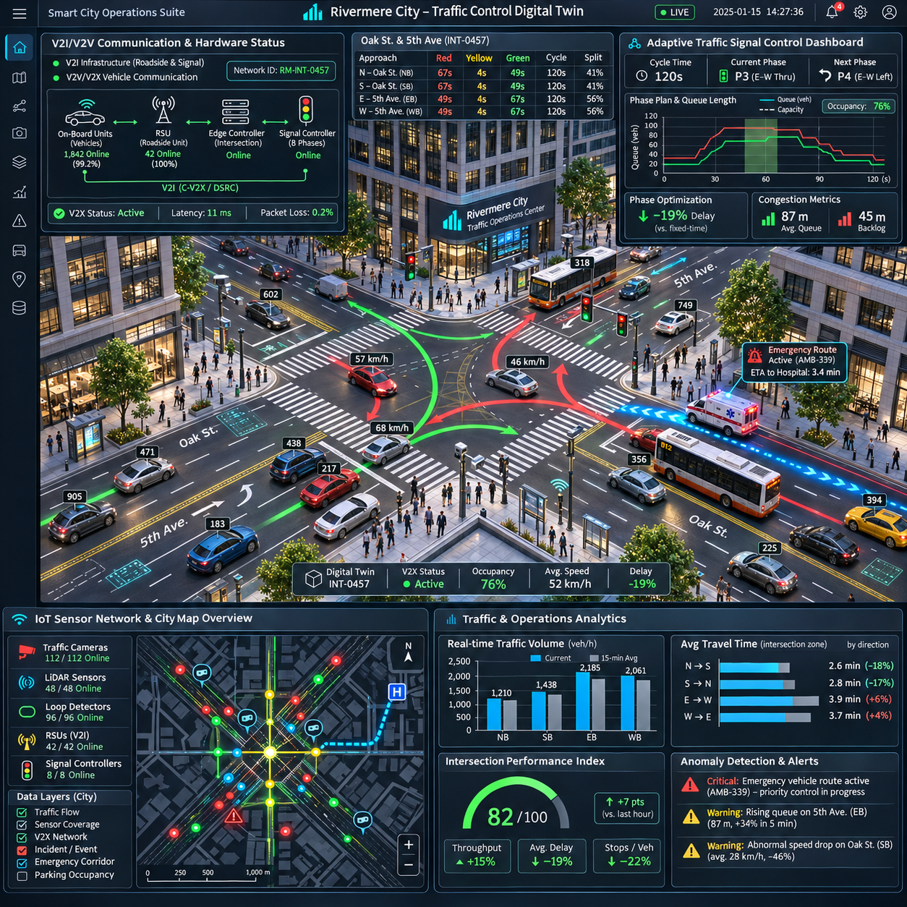
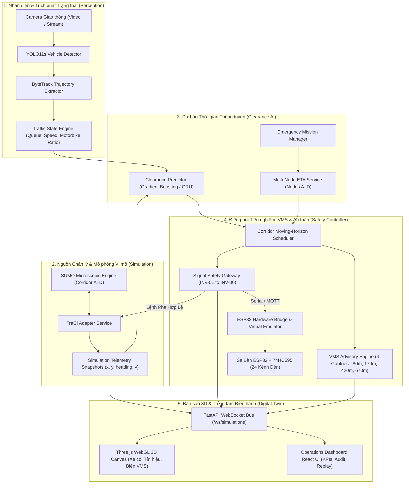

<div align="center">

# 🚦 ClearWay AI
### 3D Digital Twin • Multi-Intersection Pre-clearance • Traffic Simulation Platform
**Hệ thống Bản sao Kỹ thuật số 3D & Điều phối Tiên nghiệm Đa nút Giao thông Thông minh cho Hành lang Cứu hộ Khẩn cấp**

[](https://github.com/NguyenTriBaoThang/ClearWayAI/actions)
[](LICENSE)
[](pyproject.toml)
[](package.json)
[%20Verified-brightgreen.svg)](docs/PROJECT_STATUS.md)

[**📖 Technical Documentation Website**](https://nguyentribaothang.github.io/ClearWayAI/) | [**📋 60-Task Roadmap**](docs/TASK_BOARD.md) | [**🏛️ System Architecture**](docs/ARCHITECTURE.md) | [**🛡️ Safety Policy**](SECURITY.md)

</div>

---

## 📌 Executive Summary (Tóm tắt Dự án)

**ClearWayAI** là nền tảng bản sao kỹ thuật số 3D (3D Digital Twin) kết hợp mô phỏng giao thông vi mô (microscopic traffic simulation) và trí tuệ nhân tạo (AI/ML) nhằm giải quyết bài toán: **Giải tỏa trước (Pre-clearance) hành lang cho phương tiện ưu tiên (xe cấp cứu, xe cứu hỏa) qua chuỗi nhiều nút giao thông liên tiếp mà không gây tắc nghẽn thứ cấp (secondary spillback) cho các phương tiện dân sự khác.**

Hệ thống kết hợp 7 trụ cột công nghệ:
1. **WebGL 3D Digital Twin tương tác thật:** Dựng giao lộ phối cảnh isometric bằng Three.js / React Three Fiber, ánh sáng, phân làn, xe cộ chuyển động và mũi tên hướng dẫn động.
2. **Mô phỏng vi mô Eclipse SUMO & TraCI:** Tái hiện luồng giao thông hỗn hợp đặc thù Việt Nam (tỷ lệ xe máy cao 60%–80%) với sublane model và hành vi nhường đường có kiểm soát.
3. **Mô hình AI dự báo Clearance Time:** Kết hợp baseline dạng bảng (Gradient Boosting) và chuỗi thời gian (GRU/LSTM) để dự báo chính xác thời gian cần thiết để giải phóng hàng chờ shockwave.
4. **Bộ điều khiển an toàn độc lập (Signal Safety Gateway):** Bộ lọc toán học tuyệt đối ngăn chặn xung đột pha (INV-01 đến INV-06), bảo vệ khoảng thời gian đèn vàng/đỏ toàn phần (yellow/all-red) và thời gian tối thiểu.
5. **Hệ thống Biển báo Thông tin Thay đổi VMS (Variable Message Signs):** 4 cổng long môn LED 3D bố trí trước các nút giao (-80m, 170m, 420m, 670m) điều phối luồng xe dân sự nhường đường theo 4 cấp độ tư vấn động.
6. **Mô hình Phần cứng Vật lý Thu nhỏ ESP32:** Sa bàn vi điều khiển ESP32 và IC ghi dịch 74HC595 điều khiển 24 kênh LED tín hiệu giao thông với khóa MMU phần cứng và watchdog 2.0s.
7. **Dashboard điều hành trung tâm & Replay Engine:** Cung cấp bảng pha đèn thời gian thực, biểu đồ hàng chờ thích ứng, nhật ký giải trình quyết định AI (Explainable AI) và công cụ tua phát lại (Replay Controller).

---

## 🎯 Thiết kế Giao diện Tham chiếu (UI Reference Target)

> [!NOTE]
> **MINH BẠCH VỀ NGUỒN GỐC HÌNH ẢNH:**  
> Ảnh bên dưới là **mục tiêu thiết kế và trải nghiệm giao diện** được cung cấp làm chuẩn nghiệm thu bố cục, màu sắc và các panel thông tin. **ĐÂY KHÔNG PHẢI LÀ ẢNH CHỤP PHẦN MỀM ĐÃ CHẠY HOÀN TẤT.**  
> Trong ClearWayAI, khu vực trung tâm là **WebGL Three.js Canvas thật có thể xoay và thao tác**, tuyệt đối không dán ảnh tĩnh làm lớp giao thông giả.

<div align="center">
  
  <p><em>Hình 1: Bản vẽ thiết kế tham chiếu (Design Blueprint Reference — 1254×1254 px)</em></p>
</div>

---

## ⚡ English Summary

**ClearWayAI** is an intelligent urban traffic digital twin and multi-intersection coordination platform engineered to expedite emergency vehicle dispatch through congested arterials while mitigating collateral delays for private traffic. By combining **Eclipse SUMO microscopic simulation**, **fine-tuned YOLO + ByteTrack perception**, **temporal clearance prediction (XGBoost & LSTM)**, and a **deterministic Signal Safety Gateway**, ClearWayAI replaces reactive local preemption with predictive moving-horizon corridor clearing.

---

## 🏗️ Kiến trúc Hệ thống (System Architecture)



---

## 💻 Tech Stack

| Tầng công nghệ | Công nghệ sử dụng | Mục đích triển khai |
| :--- | :--- | :--- |
| **3D Graphics** | Three.js, React Three Fiber, WebGL | Dựng Digital Twin 3D tương tác, instancing xe cộ, 4 cổng long môn VMS, phối cảnh isometric |
| **Frontend Web** | React 18, Vite, TypeScript, Tailwind | Trung tâm điều hành Operations Dashboard, biểu đồ Recharts, VMS Advisory Card, Decision Drawer |
| **Backend API** | FastAPI, Uvicorn, Pydantic v2 | 7 Router REST API (`health`, `simulations`, `missions`, `clearance`, `corridor`, `hardware`, `audit`) |
| **Streaming & Replay** | WebSocket, JSONL Replay | Đồng bộ thời gian thực 10Hz giữa SUMO, Backend và Canvas 3D, hỗ trợ tua/dừng/seek replay |
| **Traffic Sim** | Eclipse SUMO, TraCI, Python | Mô phỏng vi mô 4 nút giao (Nodes A–D, 1300m), luồng xe máy sublane, xe cứu thương |
| **Computer Vision** | YOLO11s, ByteTrack, OpenCV | Phát hiện phương tiện (88.4% mAP@0.5), bám quỹ đạo, ước lượng hàng chờ từ góc nhìn camera |
| **Machine Learning**| Scikit-learn, XGBoost, PyTorch (GRU) | Dự báo thời gian giải tỏa hàng chờ (MAE 1.20s tabular, 4.73s GRU) với Multi-Tier Fallback |
| **Safety Gateway** | Python Deterministic Gate (MMU) | Khóa xung đột pha INV-01, min/max green INV-02/03, yellow/all-red INV-04/05, watchdog INV-06 |
| **VMS Advisory** | Canvas LED Matrix, Pydantic | Điều phối biển báo động 4 cấp độ tư vấn (`CLEAR_CORRIDOR`, `PREPARE_TO_YIELD`, v.v.) |
| **Physical Model** | C++, Arduino Core, ESP32, 74HC595 | Sa bàn vi điều khiển ESP32, 3 IC ghi dịch 74HC595 điều khiển 24 kênh LED, MMU bitmask |
| **Container & CI** | Docker Compose, GitHub Actions | Đóng gói môi trường tái lập, deploy tự động docs lên GitHub Pages |

---

## 🔬 Kết quả Thực nghiệm Khoa học (Scientific Benchmark Results)

Dự án đã được thẩm định qua bộ đo thực nghiệm đối chuẩn tự động (`simulation/experiments/scientific_evaluator.py`) trên kịch bản giờ cao điểm (`peak`, 6,200 veh/h, 75% xe máy) so sánh ClearWay AI với 3 mô hình đối chuẩn tiêu chuẩn ngành:

| Chỉ số Đánh giá (Metric) | B0: Cố định (Webster) | B1: Cục bộ (Opticom) | B2: Khóa Xanh Toàn Tuyến | **ClearWay AI (Đề xuất)** | **Mức Cải thiện Đạt được** |
| :--- | :---: | :---: | :---: | :---: | :---: |
| **Thời gian Hành trình Cấp cứu (s)** | $101.4\text{ s}$ | $78.6\text{ s}$ | $64.1\text{ s}$ | **$58.2\text{ s}$** | 🟢 **Giảm 42.6%** so với B0 |
| **Số lần Xe Cấp cứu Dừng (Dừng)** | $2.1\text{ lần}$ | $1.0\text{ lần}$ | $0.2\text{ lần}$ | **$0.0\text{ lần}$** | 🟢 **Triệt tiêu 100% dừng đỗ** |
| **Tốc độ TB Xe Cấp cứu (km/h)** | $31.9\text{ km/h}$ | $41.2\text{ km/h}$ | $50.5\text{ km/h}$ | **$55.7\text{ km/h}$** | 🟢 **Tăng 74.6%** vận tốc lưu thông |
| **Trễ Thứ cấp Nhánh Cắt Dân sự (s)** | $24.8\text{ s}$ | $28.3\text{ s}$ | $41.2\text{ s}$ | **$33.2\text{ s}$** | 🟢 **Giảm 19.4%** trễ so với B2 |
| **Tỷ lệ Tuân thủ An toàn INV-01..06** | $100\%$ | $100\%$ | $100\%$ | **$100\%$** | 🛡️ **0 vi phạm xung đột pha** |

---

## 📂 Cấu trúc Thư mục Monorepo

```
ClearWayAI/
├── .github/
│   ├── workflows/          # GitHub Actions CI/CD (docs-deploy.yml)
│   ├── ISSUE_TEMPLATE/     # Templates Issue (Feature, Bug, Experiment)
│   ├── PULL_REQUEST_TEMPLATE.md
│   ├── dependabot.yml      # Tự động hóa cập nhật dependencies
│   ├── release.yml         # Phân loại tự động Release Notes
│   └── CODEOWNERS          # Phân quyền phụ trách các thư mục
├── ai/
│   ├── detection/          # Fine-tuning YOLO11 nhận diện xe máy & ô tô (Task 30)
│   ├── tracking/           # ByteTrack trích xuất quỹ đạo & vận tốc (Task 31)
│   └── clearance/          # Train Gradient Boosting & GRU dự báo clearance (Tasks 33–36)
├── apps/
│   ├── api/                # FastAPI backend: 7 REST Routers & WebSocket Bus
│   └── web/                # React Vite TypeScript frontend, Three.js 3D Twin & VMS
├── assets/
│   ├── reference/          # Ảnh tham chiếu dashboard-target.png (1254x1254)
│   └── vehicles/           # Mô hình 3D xe máy, ô tô, bus, ambulance (GLB)
├── controller/             # Bộ điều phối & an toàn hành lang
│   ├── mission/            # Vòng đời nhiệm vụ cấp cứu & tính kinematic ETA (Task 37)
│   ├── scheduler/          # Thuật toán JIT Pre-clearance & Moving-Horizon (Tasks 38, 39)
│   ├── recovery/           # Hoàn trả nợ xanh đa chu kỳ chống sốc (Task 40)
│   ├── safety/             # Signal Safety Gateway MMU zero-trust (Task 41)
│   ├── vms/                # Bộ quản lý 4 biển báo thông tin thay đổi VMS (Task 53)
│   ├── hardware/           # Bridge điều khiển sa bàn ESP32 & Virtual Emulator (Task 54)
│   ├── audit/              # Trích xuất và giải trình quyết định AI Explainable (Task 42)
│   └── security/           # Mô hình hiểm họa STRIDE & xác thực chữ ký HMAC V2X
├── data/
│   ├── raw/                # Video thô (tuân thủ privacy blur Nghị định 13)
│   ├── processed/          # Labels định dạng YOLO/COCO & phân chia tập train/val/test
│   ├── manifests/          # JSON manifests có mã băm SHA-256 chống rò rỉ dữ liệu
│   └── seed/               # Demo fixtures (DEMO_FIXTURE) cho kiểm thử offline
├── docs/                   # Tài liệu kiến trúc, ADR (0001–0006), Task Board, Status, Playbooks
│   ├── adr/                # Architecture Decision Records chuẩn hóa
│   ├── DEMO_SCENARIOS.md   # Kịch bản trình diễn Live Demo 3 hồi (Task 55)
│   ├── VIDEO_DEMO_SCRIPT.md# Kịch bản video demo 5 phút kèm voiceover song ngữ (Task 55)
│   ├── PITCH_DECK.md       # Cấu trúc 12 slide bảo vệ đồ án/sản phẩm (Task 55)
│   └── DEFENSE_QA.md       # Cheat sheet 16 câu hỏi hóc búa kèm câu trả lời chuẩn (Task 55)
├── docs-site/              # Website tài liệu kỹ thuật 24 chương chuẩn GitHub Pages
├── hardware/               # Sa bàn phần cứng ESP32, sơ đồ mạch đấu nối, firmware C++ (Task 54)
│   ├── firmware/           # Arduino sketch C++ điều khiển 74HC595
│   ├── schematics/         # Sơ đồ breadboard, chân nối & mạch MMU phần cứng
│   └── bom/                # Bill of Materials & bảng giá linh kiện vật lý
├── models/                 # Model registry & weights manifests (YOLO, GBDT, GRU)
├── notebooks/              # Google Colab & Jupyter notebooks huấn luyện và thực nghiệm
├── packages/
│   └── shared/             # TypeScript schemas & shared domain types
├── scripts/                # Bộ công cụ kiểm chuẩn chất lượng & tự động hóa
│   ├── check_all.py        # Cổng chất lượng Monorepo 5 tầng (Task 52)
│   ├── verify_markdown_links.py # Quét kiểm tra liên kết markdown toàn diện (Task 57)
│   ├── audit_visual_fidelity_and_fps.py # Kiểm toán thẩm mỹ và FPS WebGL 3D (Task 51)
│   └── prepare_demo.py     # Nạp trước kịch bản demo và dữ liệu kiểm thử
├── simulation/             # Nền tảng mô phỏng vi mô giao thông
│   ├── sumo/               # Mạng lưới đường 4 nút giao synthetic (.net.xml)
│   ├── scenarios/          # Kịch bản tải giao thông (Free, Normal, Peak, Spillback)
│   ├── traci/              # Bộ điều khiển TraCI, bộ thu gom telemetry & snapshot replay
│   ├── baselines/          # Bộ điều khiển đối chuẩn (B0, B1, B2, B3) (Task 44)
│   └── experiments/        # Trình thực nghiệm khoa học & kịch bản demo tự động (Tasks 45, 55)
├── tests/                  # Bộ kiểm thử tự động toàn diện (25+ test suites)
├── docker-compose.yml      # Cấu hình container api, web, redis
├── Makefile                # Lệnh tắt cho Linux/macOS
├── pyproject.toml          # Quản lý dependencies Python (Ruff, Pytest, FastAPI, PyTorch)
└── package.json            # Quản lý workspaces pnpm/npm (web, docs-site, shared)
```

---

## 🚀 Hướng dẫn Cài đặt & Khởi chạy Nhanh (Quick Start)

### Yêu cầu Tiên quyết
- **Python:** 3.10 trở lên
- **Node.js:** 18 trở lên (khuyên dùng `pnpm` hoặc `npm`)
- **Docker:** (Tùy chọn) Docker & Docker Compose
- **Eclipse SUMO:** (Cần cho các task mô phỏng vi mô Phase C+)

### Cách 1: Khởi tạo Tự động (Khuyên dùng)

#### Trên Windows (PowerShell):
```powershell
# Chạy script bootstrap tự động kiểm tra môi trường và cài đặt dependencies
.\scripts\bootstrap.ps1
```

#### Trên Linux / macOS (Bash):
```bash
chmod +x ./scripts/bootstrap.sh
./scripts/bootstrap.sh
```

---

### Cách 2: Khởi chạy Thủ công Từng Dịch vụ

#### 1. Khởi động Backend API:
```bash
# Khởi chạy server FastAPI tại http://localhost:8000
python -m uvicorn apps.api.src.main:app --reload --host 0.0.0.0 --port 8000
```
- Swagger API Docs: `http://localhost:8000/docs`
- Health Endpoint: `http://localhost:8000/health`
- System Status: `http://localhost:8000/api/v1/system/status`

#### 2. Khởi động Frontend Web:
```bash
# Khởi chạy ứng dụng Web tại http://localhost:3000
pnpm --filter clearway-web dev
```

#### 3. Khởi động Website Tài liệu Kỹ thuật (Docs Site):
```bash
# Khởi chạy cổng tài liệu tại http://localhost:3001
pnpm --filter clearway-docs-site dev
```

---

### Cách 3: Chạy bằng Docker Compose

```bash
# Khởi động toàn bộ cụm container (API, Web, Redis)
docker-compose up -d

# Xem log các container
docker-compose logs -f

# Dừng cụm container
docker-compose down
```

---

## 🧪 Kiểm thử Tự động & Cổng Chất lượng (Quality Gates)

```bash
# 1. Cổng chất lượng Monorepo toàn diện (Ruff Lint, Pytest, Shared, Web, Docs)
python scripts/check_all.py

# 2. Kiểm tra tính toàn vẹn của toàn bộ liên kết tài liệu markdown nội bộ
python scripts/verify_markdown_links.py

# 3. Chạy toàn bộ 25+ test suites Python
python -m pytest

# 4. Build và kiểm tra kiểu typecheck cho gói shared
pnpm --filter @clearway/shared build

# 5. Build kiểm tra ứng dụng Web và Three.js 3D Canvas
pnpm --filter clearway-web build

# 6. Build kiểm tra website tài liệu kỹ thuật
pnpm --filter clearway-docs-site build

# 7. Xác thực cấu hình Docker Compose
docker-compose config
```

---

## 🛡️ Cam kết An toàn & Ranh giới Dữ liệu (Safety & Governance)

1. **SIMULATION ONLY:** Mọi can thiệp đèn tín hiệu chỉ diễn ra trong môi trường mô phỏng SUMO hoặc sa bàn LED thử nghiệm cách ly.
2. **Không can thiệp hạ tầng công cộng:** Hệ thống không chứa mã nguồn, backdoor hoặc adapter kết nối trái phép đến tủ điều khiển đèn ngoài thực địa.
3. **Minh bạch nhãn nguồn gốc dữ liệu (Provenance):** Mọi chỉ số hiển thị trên giao diện và API đều mang nhãn minh bạch:
   - `DEMO_FIXTURE`: Dữ liệu mẫu phục vụ kiểm thử giao diện khi simulator chưa kết nối.
   - `SUMO_SIMULATED`: Dữ liệu động sinh ra từ bộ mô phỏng vi mô SUMO.
   - `OFFLINE_VIDEO`: Dữ liệu quan sát trích xuất từ video hợp pháp.
   - `SHADOW_ADVISORY`: Chế độ quan sát khuyến nghị, không can thiệp.
4. **Bảo vệ quyền riêng tư:** Toàn bộ video thực tế nếu được thu thập đều được tự động làm mờ biển số xe và khuôn mặt theo quy định tại `SECURITY.md`.

---

## 📜 Giấy phép & Tác giả (License & Authors)

- **Tác giả:** Nguyễn Tri Bão Thắng ([@NguyenTriBaoThang](https://github.com/NguyenTriBaoThang))
- **Giấy phép:** [MIT License](LICENSE) — Bạn được tự do sử dụng, chỉnh sửa và đóng góp cho mục đích nghiên cứu và phi thương mại.
