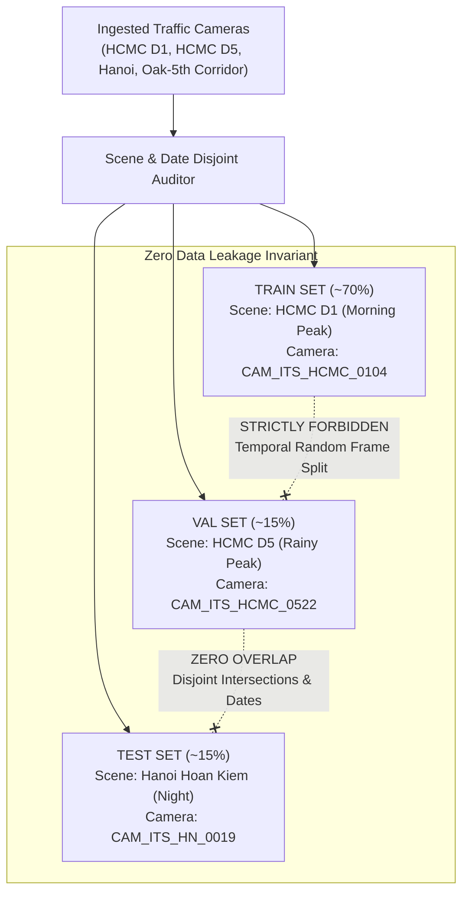

# ClearWayAI Computer Vision Annotation Guide & Zero-Leakage Dataset Splitting

> **Vietnamese Mixed Traffic Object Detection & Tracking Specification (YOLOv8/v11 & COCO)**  
> **Mandatory Invariant:** Strict Zero Temporal & Spatial Data Leakage via Scene-Based Partitioning.

---

## 1. Overview & Core Objectives

Urban roadways in Vietnam exhibit extreme mixed-traffic dynamics dominated by two-wheelers ($70\%\text{--}80\%$ motorcycles), dense lateral clustering without strict lane adherence, and critical emergency corridor requirements. ClearWayAI’s computer vision pipeline (Tasks 28–32) requires robust detection across 7 fine-grained vehicle classes under variable weather and lighting conditions.

This document formalizes:
1. The **7-Class Taxonomy** aligned with the system domain model (`VehicleType`).
2. Exact **Bounding Box Labeling Protocols** (tightness, motorcycle swarms, occlusion, truncation).
3. The **Zero Temporal/Spatial Data Leakage Policy** for train/val/test dataset partitioning.
4. Cryptographic integrity and automated quality gate validation.

---

## 2. 7-Class Vehicle Taxonomy

ClearWayAI standardizes on 7 mutually exclusive vehicle classes indexed $0$ through $6$:

| Class ID | Class Name | Vietnamese Term | Description & Typical Models | Boundary Rules |
| :---: | :--- | :--- | :--- | :--- |
| **0** | `motorcycle` | Xe máy, xe hai bánh | Honda Wave, AirBlade, SH, Yamaha Exciter, VinFast Klara/Feliz, Cub, e-scooters. | **Must enclose rider + passenger(s) + all attached cargo/delivery racks.** |
| **1** | `car` | Ô tô con, sedan | Toyota Vios, Hyundai Accent, Kia Morning, Mazda 3, Honda Civic (sedan/hatchback $\le 5$ seats). | Tightly enclose front bumper to rear bumper, roof to tire contact points. |
| **2** | `suv` | SUV, CUV, MPV, bán tải | Toyota Fortuner, Mitsubishi Xpander, Ford Ranger, VinFast VF8, Kia Carnival. | Differentiate from sedan by ground clearance and body height ($>1.6\text{ m}$). |
| **3** | `bus` | Xe buýt, xe khách | VinBus, Daewoo/Samco city buses, Ford Transit (16 seats), Hyundai Universe (45 seats). | Large passenger vehicles; includes minivans and long-distance coaches. |
| **4** | `truck` | Xe tải, container | Isuzu/Hino flatbeds, box trucks, tippers, container haulers, concrete mixers. | Exclude small consumer pickup trucks (labeled as `suv`). |
| **5** | `ambulance` | Xe cứu thương | Emergency medical vans (Toyota HiAce, Hyundai Starex) with rooftop lightbar, siren, AMB-339. | **High priority:** Verify red cross, "CẤP CỨU", or active emergency lightbar. |
| **6** | `fire_engine` | Xe cứu hỏa | Municipal fire department pumper trucks, ladder trucks (red/high-vis yellow). | Distinctive red chassis, high-mounted flashing beacons, equipment ladders. |

---

## 3. Bounding Box Annotation Protocols

Annotations follow the standard normalized YOLO text format:
$$\text{<class\_id>} \quad \text{<x\_center>} \quad \text{<y\_center>} \quad \text{<width>} \quad \text{<height>}$$
where all coordinates are normalized to the interval $[0.0, 1.0]$.

### 3.1 Tightness & Boundary Anchors
- **Tire Contact:** The bottom edge of the box must align with the contact patch between tires and the pavement.
- **Side Mirrors & Antennae:** Include mirrors if clearly visible; exclude thin wire radio antennae.
- **Luggage Racks & Delivery Baskets:** Popular in Vietnamese delivery networks (Shipper bags, thùng xốp). These **must be included** within the `motorcycle` bounding box as they define the physical clearance envelope required for corridor safety.

### 3.2 Motorcycle Swarms & Lateral Clustering
During peak hours, up to 30 motorcycles may queue within a $10\times 10\text{ m}$ stopline zone.
- **Rule:** Each vehicle-rider unit receives an **individual, distinct bounding box**.
- **Heavy Overlap:** When riders are bumper-to-bumper or handlebar-to-handlebar, overlap between bounding boxes is expected and permitted. Do NOT merge adjacent riders into a single group box.

### 3.3 Occlusion Handling
Vehicles occluded by poles, street trees, or other vehicles are annotated according to visible surface area:
- **$\ge 20\%$ Visible (20% visibility threshold):** Annotate the full estimated bounding box enclosing the visible parts.
- **$< 20\%$ Visible:** **Do not annotate**. Avoid ambiguous noise that destabilizes detector convergence.
- **Severely Occluded Drivers:** If only the head/helmet of a rider is visible behind a large truck, omit the annotation.

### 3.4 Image Boundary Truncation
Vehicles entering or exiting the camera field of view are cut off at the sensor boundary:
- Clip the box strictly to the image frame ($[0, 1]$ coordinate space).
- Do **not** extrapolate coordinates beyond the visible image limits.

---

## 4. Zero Temporal & Spatial Data Leakage Policy

### 4.1 The Flaw of Naive Random Splitting
Standard random splitting (e.g. `train_test_split(test_size=0.2)`) on continuous traffic video causes catastrophic data leakage:
- Consecutive frames at 30 FPS share identical backgrounds, static queued vehicles, identical lighting, and parked cars.
- Models evaluated on randomly split frames achieve artificially high mAP ($>95\%$), but fail drastically when deployed on a new intersection.

### 4.2 The Scene-Based & Session-Based Invariant
ClearWayAI strictly enforces **Disjoint Scene Partitioning**:
1. **Scene Isolation:** All frames from a specific intersection scene (`camera_id` / `intersection_name`) belong exclusively to **one** split.
2. **Temporal Isolation:** If an intersection is captured across multiple days, all sessions from that location must stay within the same partition.
3. **Distribution Ratios:**
   - **Train (~70%):** Primary training scenes representing dense daytime commute traffic (e.g., HCMC D1 morning peak).
   - **Validation (~15%):** Distinct scene used for hyperparameter tuning and early stopping (e.g., HCMC D5 evening rain).
   - **Test (~15%):** Completely unseen scene used for final benchmark reporting (e.g., Hanoi Hoan Kiem night).
4. **Synthetic Simulation Data:** SUMO digital twin captures (`provenance="SUMO_SIMULATED"`) are partitioned into dedicated simulation train/test splits.

---

## 5. Automated Verification & Quality Gates

The integrity of all dataset splits is verified through automated pre-commit and CI gates:
- `data/scripts/check_dataset_leakage.py`:
  - Asserts that the intersection of scene IDs between splits is strictly $\emptyset$.
  - Asserts that file content hashes (SHA-256) are mutually disjoint.
  - Verifies that all bounding box coordinates satisfy $0.0 \le x, y, w, h \le 1.0$.
  - Confirms all 7 vehicle classes are present across the dataset.

