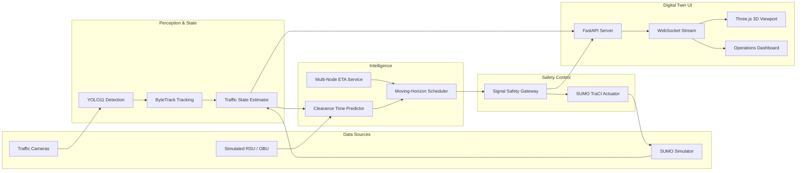

# ClearWayAI System Architecture Document

This document provides the foundational engineering specification, subsystem boundaries, data flow pipelines, and mathematical models of the ClearWayAI platform.

---

## 1. High-Level Architecture Overview

ClearWayAI is designed as an event-driven modular architecture bridging real-time microscopic traffic simulation, deep learning perception, predictive clearance regression, and a WebGL 3D Digital Twin.

---

## 2. Mathematical Formulations

### 2.1 Predictive Pre-clearance Trigger Condition

$$\Delta t_{\text{trigger}} = \text{ETA}_{\text{EV}} - \hat{T}_{\text{clear}} - T_{\text{transition}} - T_{\text{buffer}}$$

- $\text{ETA}_{\text{EV}}$: Estimated time of arrival of the emergency vehicle at the target intersection stopline.
- $\hat{T}_{\text{clear}}$: Estimated clearance time required to evacuate the queue ahead of the emergency vehicle.
- $T_{\text{transition}}$: Fixed transition penalty: $T_{\text{yellow}} + T_{\text{all\_red}} + T_{\text{ped\_clearance}}$.
- $T_{\text{buffer}}$: Adaptive safety margin calibrated to the 95th percentile prediction residual.

### 2.2 Clearance Time Prediction Model

$$\hat{T}_{\text{clear}} = f_{\theta}\left( Q_L, \rho_{\text{moto}}, V_{\text{entry}}, O_{\text{approach}}, S_{\text{downstream}} \right)$$

- $Q_L$: Current queue length in corridor approach (meters).
- $\rho_{\text{moto}}$: Ratio of motorcycles within the queuing vehicles ($[0.0, 1.0]$).
- $V_{\text{entry}}$: Upstream vehicle entry flow rate (veh/h).
- $O_{\text{approach}}$: Approach occupancy percentage ($[0\%, 100\%]$).
- $S_{\text{downstream}}$: Downstream bottleneck occupancy and spillback probability.

---

## 3. Subsystem Boundaries & Safety Guarantees

1. **AI Output Advisory:** Outputs from machine learning models ($\hat{T}_{\text{clear}}$, trajectories, classifications) are treated as **advisory inputs**.
2. **Deterministic Gateway Authority:** Only the deterministic `SignalSafetyGateway` possesses the cryptographic capability to format phase control instructions for execution.
3. **Fail-Safe Invariants:**
   - Green conflicts are rejected with an explicit error code.
   - Minimum green interval is non-negotiable ($T \ge 10\text{s}$).
   - Any network disconnection or software crash triggers a fail-safe revert to pre-programmed Webster cycle timings.

