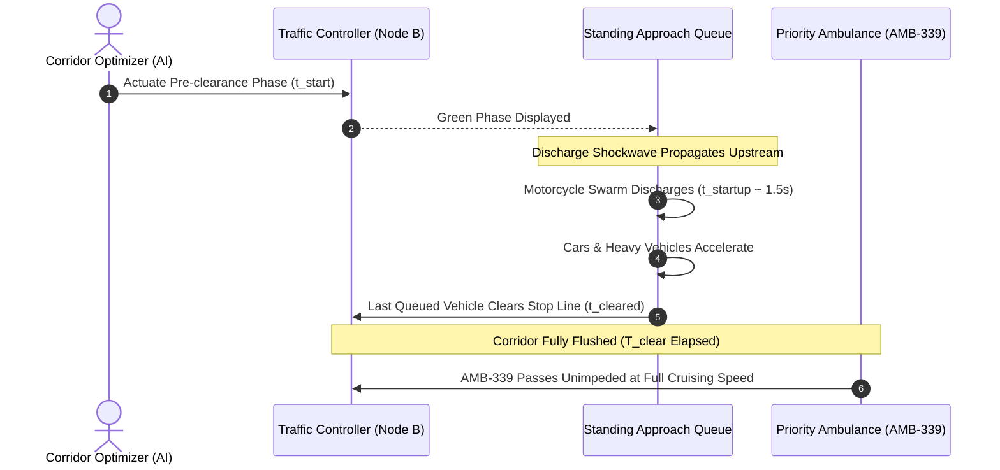

# ClearWayAI Emergency Corridor Clearance Time Specification

> **Theoretical Foundations, Mathematical Modeling & Empirical Ground Truth Generation**  
> **Target Task:** Phase E (Tasks 33–36) — Machine Learning Clearance Time Prediction.

---

## 1. Problem Formulation & Scientific Definition

In emergency pre-clearance operations (such as clearing a priority corridor for the **AMB-339** ambulance), activating an immediate green light is necessary but insufficient. If a 60-meter vehicular queue blocks the intersection approach, the emergency vehicle will be trapped behind standing traffic regardless of signal phase.

### Formal Definition of Clearance Time ($T_{\text{clear}}$)
**Clearance Time ($T_{\text{clear}}$)** is the exact duration (in seconds) required from the moment an approach clearance command or green phase is actuated at $t_{\text{start}}$ until the last vehicle in the corridor queue crosses the intersection stop line and completely vacates the conflict zone at $t_{\text{cleared}}$:

$$T_{\text{clear}} = t_{\text{cleared}} - t_{\text{start}}$$

---

## 2. Traffic Flow Dynamics in Vietnamese Mixed Traffic

Unlike homogeneous automobile traffic governed by standard Highway Capacity Manual (HCM) formulas, Vietnamese urban corridors exhibit distinctive multi-class discharge dynamics:

### 2.1 Kinematic Wave & Shockwave Propagation
When the signal turns green, a backward-propagating discharge shockwave travels through the queue at speed $w_{\text{wave}}$:
$$w_{\text{wave}} = \frac{q_{\text{sat}}}{k_{\text{jam}} - k_{\text{sat}}}$$
- Due to arbitrary lateral alignment and motorcycle clustering (Sublane model SL2015), jam density $k_{\text{jam}}$ reaches $280\text{--}350\text{ veh/km/lane}$, significantly higher than standard car traffic ($130\text{--}160\text{ veh/km/lane}$).
- Motorcycles filter through gaps to the front of the queue, experiencing minimal reaction latency ($\tau_{\text{moto}} \approx 0.8\text{ s}$).

### 2.2 Mathematical Formulation
The empirical clearance time can be modeled as:
$$T_{\text{clear}} = t_{\text{startup}}(N_{\text{veh}}, r_{\text{moto}}, N_{\text{heavy}}) + \frac{Q_{\text{len}}}{v_{\text{discharge}} \cdot \eta_{\text{weather}}} + \Delta_{\text{downstream}}(\rho_{\text{down}})$$

Where:
- $Q_{\text{len}}$: Queue length in meters from stop line to queue tail.
- $N_{\text{veh}}$: Total count of queued vehicles.
- $r_{\text{moto}}$: Motorcycle ratio ($\text{motorcycles} / N_{\text{veh}}$). Higher ratio reduces startup delay due to fast two-wheeler acceleration.
- $N_{\text{heavy}}$: Count of buses and trucks. Heavy vehicles induce significant startup lost time ($+2.5\text{ s}$ per unit).
- $v_{\text{discharge}}$: Base saturation discharge speed ($\approx 4.5\text{ m/s} \approx 16.2\text{ km/h}$).
- $\eta_{\text{weather}}$: Surface friction discount factor:
  $$\eta_{\text{weather}} = \begin{cases} 1.00 & \text{Clear} \\ 0.95 & \text{Overcast} \\ 0.82 & \text{Rain (Wet asphalt, reduced deceleration safety margins)} \\ 0.90 & \text{Haze} \end{cases}$$
- $\Delta_{\text{downstream}}$: Downstream back-pressure penalty. When downstream approach occupancy $\rho_{\text{down}} > 0.70$, queue flush slows due to spillback risk:
  $$\Delta_{\text{downstream}} = \max\left(0, \frac{\rho_{\text{down}} - 0.70}{1.0 - \rho_{\text{down}}} \times 12.0\right)$$

---

## 3. Dataset Feature Schema

The clearance dataset (`data/processed/clearance/clearance_ground_truth.csv`) records empirical simulation episodes across diverse traffic regimes:

| Feature Name | Data Type | Value Range | Description |
| :--- | :---: | :---: | :--- |
| `scenario_id` | `str` | `free_flow`, `normal`, `peak`, `spillback` | Traffic demand profile |
| `node_id` | `str` | `node_a`, `node_b`, `node_c`, `node_d` | Corridor intersection node |
| `approach_id` | `str` | `EB`, `WB`, `NB`, `SB` | Directional approach |
| `queue_length_m` | `float` | $0.0\text{--}120.0$ | Metric distance to queue tail |
| `queued_vehicle_count`| `int` | $0\text{--}60$ | Total standing vehicles |
| `motorcycle_ratio` | `float` | $0.30\text{--}0.95$ | Percentage of two-wheelers |
| `heavy_vehicle_count` | `int` | $0\text{--}8$ | Number of buses + trucks |
| `approach_occupancy` | `float` | $0.00\text{--}1.00$ | Physical approach space utilized |
| `downstream_occupancy`| `float` | $0.00\text{--}1.00$ | Bottleneck back-pressure ratio |
| `weather` | `str` | `clear`, `rain`, `overcast`, `haze` | Atmospheric condition |
| `hour_of_day` | `int` | $0\text{--}23$ | Commute period |
| `provenance` | `str` | `SUMO_SIMULATED`, `SYNTHETIC_SHOCKWAVE` | Data source tag |
| **`clearance_time_sec`** | `float` | $0.0\text{--}70.0$ | **Target Label ($T_{\text{clear}}$)** |

---

## 4. Zero Data Leakage Partitioning

To avoid temporal and spatial memorization in ML models (Tasks 34–35):
1. **Train Set (70%):** Nodes A & B under `normal` and `peak` demand.
2. **Validation Set (15%):** Node C under variable weather conditions.
3. **Test Set (15%):** Node D under unseen `spillback` stress scenarios.

