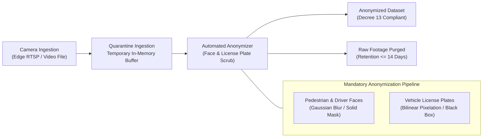

# ClearWayAI Data Governance, Privacy & Video Ingestion Framework

> **Compliance Specification with Decree 13/2023/ND-CP (Personal Data Protection) & Traffic Data Collection Protocols**

---

## 1. Regulatory Context & Legal Principles

The deployment of computer vision systems on urban transportation networks requires strict adherence to privacy laws and personal data protection regulations. ClearWayAI operates under a strict **Zero-PII (Personally Identifiable Information) Invariant**:

### Governing Legislation
1. **Decree No. 13/2023/ND-CP on Personal Data Protection (Vietnam):**
   - Article 9 & 13: General rights and protection principles of data subjects.
   - Article 17: Protection of personal data in audio-visual surveillance and public monitoring.
   - Requirement: Public video feeds collected for traffic research and signal optimization must not be linked or linkable to specific natural persons without explicit statutory authorization.
2. **Law on Cyber Security 2018 (Vietnam):**
   - Protection of national critical infrastructure and municipal traffic control data.
3. **Law on Road Traffic & Ministry of Transport Standards:**
   - Technical standards for roadside monitoring cameras and intelligent transportation systems (ITS).

---

## 2. Zero-PII Policy & Mandatory Redaction

### 2.1 Anonymization Requirements Before Storage
No raw video containing identifiable faces or legible license plates may enter model training, evaluation sets, or open repositories:



1. **Facial Anonymization:**
   - Every human face detected in vehicle cabins, motorcycle riders, and pedestrians must undergo Gaussian blurring with $\sigma \ge 5.0$ or solid rectangular blackout redaction.
2. **License Plate Obfuscation:**
   - All vehicle license plates (two-line motorcycle plates, rectangular automobile plates) must be obfuscated using bilinear pixelation ($16 \times 16$ kernel) or solid fill.
3. **Automated Verification:**
   - Every ingested clip must pass an automated secondary audit filter asserting zero legible text characters inside detected vehicle plate regions.

---

## 3. Video Collection & Sensor Ingestion Protocols

### 3.1 Field Video Specifications
To train robust YOLO detection (T30) and ByteTrack trajectory tracking (T31) under Vietnamese traffic conditions, video captures must satisfy standardized engineering criteria:

| Parameter | Standard Requirement | Justification |
| :--- | :--- | :--- |
| **Resolution** | Full HD ($1920 \times 1080$) or $2K$ ($2560 \times 1440$) | Distinguishes small motorcycles ($0.7\text{ m}$) at $50\text{ m}$ distance |
| **Frame Rate** | $30\text{ FPS}$ (constant frame rate) | Accurate velocity and acceleration calculation without temporal jitter |
| **Mounting Height** | $5.5\text{ m}$ to $8.0\text{ m}$ above grade | Minimizes visual occlusion during high-density motorcycle swarming |
| **Camera Pitch Angle**| $25^\circ$ to $40^\circ$ downward depression | Balances queue depth perception with stopline boundary accuracy |
| **Codec & Container** | H.264 / H.265 in `.mp4` container | Wide hardware decoder compatibility across edge nodes and GPU servers |

### 3.2 Environmental & Lighting Diversity Matrix
Ingested datasets must encompass balanced operational conditions:
- **Weather Variations:**
  - `clear`: Sunny, high contrast, casting shadows.
  - `overcast`: Diffuse lighting, low shadow interference.
  - `rain`: Wet asphalt reflections, wiper blade motion, raindrop artifacts on lens.
  - `haze`: Low contrast during urban fog or heavy smog.
- **Time-of-Day Profiles:**
  - `morning_peak` ($07:00\text{--}09:00$): Heavy motorcycle swarming and commute surge.
  - `evening_peak` ($17:00\text{--}19:30$): Maximum queue buildup and emergency corridor stress.
  - `midday` ($11:30\text{--}14:00$): Normal commercial traffic and sunlight glare.
  - `night` ($20:00\text{--}05:00$): Low-light conditions, headlight glare, streetlight reflections.

---

## 4. Metadata Manifest Schema & Chain of Custody

Every video sequence stored in the ClearWayAI data repository must be accompanied by an immutable JSON manifest in `data/manifests/` detailing its origin, physical attributes, cryptographic digests, and compliance status:

```json
{
  "manifest_version": "1.0.0",
  "video_id": "VID_20261123_HCMC_D1_001",
  "provenance": "OFFLINE_VIDEO",
  "location": {
    "city": "Ho Chi Minh City",
    "district": "District 1",
    "intersection_name": "Nguyen Thi Minh Khai & Pasteur",
    "camera_id": "CAM_ITS_HCMC_0104",
    "gps_coordinates": [10.7769, 106.6953]
  },
  "time_period": {
    "start_utc": "2026-11-23T01:00:00Z",
    "end_utc": "2026-11-23T01:03:00Z",
    "time_of_day": "morning_peak"
  },
  "weather_condition": "clear",
  "video_spec": {
    "resolution": [1920, 1080],
    "fps": 30.0,
    "duration_seconds": 180.0,
    "format": "mp4",
    "codec": "h264"
  },
  "privacy_compliance": {
    "face_blurred": true,
    "license_plate_blurred": true,
    "decree_13_compliant": true,
    "anonymizer_version": "ClearWay-Scrub-1.2.0"
  },
  "integrity": {
    "sha256_raw": "e3b0c44298fc1c149afbf4c8996fb92427ae41e4649b934ca495991b7852b855",
    "sha256_anonymized": "d4735e3a265e16eee03f59718b9b5d03019c07d8b6c51f90da3a666eec13ab35",
    "file_size_bytes": 48259104
  },
  "traffic_characteristics": {
    "dominant_vehicle": "motorcycle",
    "motorcycle_percentage": 76.5,
    "estimated_density": "high",
    "estimated_flow_rate_vph": 4350
  }
}
```

---

## 5. Storage Tiers & Data Retention Schedules

1. **Tier 1 (Raw Ingress Quarantine):**
   - Encrypted at rest (AES-256).
   - Access restricted to automated scrub workers.
   - **Retention Limit:** Strictly deleted within **14 calendar days** following successful anonymization.
2. **Tier 2 (Anonymized Computer Vision Training Sets):**
   - Privacy-scrubbed clips and COCO/YOLO annotations.
   - May be retained indefinitely for academic benchmarking and model training.
3. **Tier 3 (Synthetic SUMO & Digital Twin Telemetry):**
   - Simulated vehicle trajectories and rendered digital twin clips (`provenance="SUMO_SIMULATED"`).
   - Excluded from Decree 13 restrictions as no biological persons are involved.

---

## 6. Audit & Enforcement Checklist

- [x] Decree 13/2023/ND-CP compliance confirmed.
- [x] Face and license plate obfuscation mandatory on all physical video ingress.
- [x] Scene-based partitioning enforced (no temporal leakage across adjacent frames).
- [x] SHA-256 cryptographic hashes logged in JSON manifests.
- [x] Clear data provenance tagging (`OFFLINE_VIDEO` vs `SUMO_SIMULATED` vs `DEMO_FIXTURE`).
