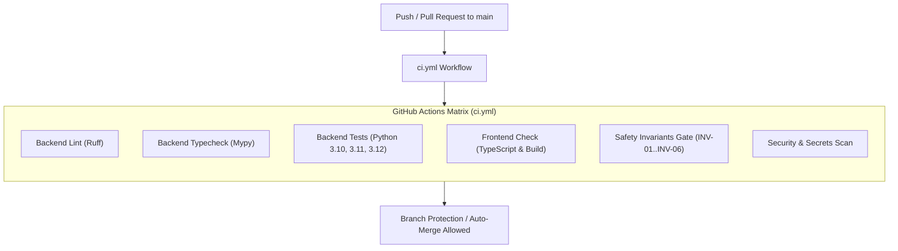

# ClearWayAI Development Environment & CI/CD Pipeline

> **Standardized Local Development, Code Quality Standards, and Continuous Integration**

---

## 1. Quick Start Guide

### Prerequisites
- **Python**: $\ge 3.10$ (3.11 recommended)
- **Node.js**: $\ge 20.0.0$
- **pnpm**: $\ge 9.0.0$
- **Git**: with Git LFS enabled
- **SUMO** *(Optional for Phase A/B, required for Phase C+)*: $\ge 1.19.0$

### 3-Step Setup
```bash
# 1. Clone repository
git clone https://github.com/NguyenTriBaoThang/ClearWayAI.git
cd ClearWayAI

# 2. Run developer environment bootstrapper (creates .env templates & validates tools)
python scripts/dev_setup.py

# 3. Install dependencies
pip install -r requirements.txt
pip install ruff mypy
pnpm install
```

---

## 2. Monorepo Quality Gates & Linters

ClearWayAI enforces strict code style, typing, and safety boundary invariants across all modules.

### Local Quality Check in One Command
Run the all-in-one verification runner:
```bash
python scripts/check_all.py
```
This runs:
1. **Markdown Documentation Link Validator**: Ensures zero dead links across 28+ documentation files.
2. **Safety Boundaries & JSON Schema Invariants**: Confirms mutual exclusion matrices and MMU bounds.
3. **Ruff Linter**: Fast Python linting and PEP8 formatting compliance.
4. **Mypy Typecheck**: Static type verification across backend domain models.
5. **Pytest Test Suite**: Runs all unit, integration, and UI acceptance gate tests.

### Targeted Commands
```bash
# Python Linting
python -m ruff check .
python -m ruff format --check .

# Python Formatting Autofix
python -m ruff format .
python -m ruff check --fix .

# Static Typing
python -m mypy apps/api/src

# Run Pytest
python -m pytest tests/ -v
```

---

## 3. Pre-Commit Hooks

Git pre-commit hooks ensure broken code or credentials are never accidentally committed.

```bash
# Install pre-commit hooks into .git/hooks/
pre-commit install
```

Configured hooks in `.pre-commit-config.yaml`:
- `trailing-whitespace`: Trims accidental trailing whitespace.
- `end-of-file-fixer`: Ensures files end in a clean single newline.
- `check-yaml` & `check-json`: Validates syntax of config files.
- `check-added-large-files`: Prevents accidental binary blobs $> 5\text{MB}$.
- `detect-private-key`: Blocks accidental commitment of RSA/OpenSSH private keys.
- `ruff` & `ruff-format`: Enforces code formatting automatically before commit.
- `check-doc-links`: Runs `scripts/verify_markdown_links.py` to prevent broken references.

---

## 4. Continuous Integration (CI/CD) Architecture

All changes merged into `main` or submitted via Pull Request are verified through GitHub Actions:



### CI Workflows
- **`.github/workflows/ci.yml`**: Full PR validation pipeline (multi-job, matrix test, safety gate).
- **`.github/workflows/nightly-benchmark.yml`**: Nightly scheduled benchmark at 02:00 UTC for FPS & regression audits.
- **`.github/workflows/docs-deploy.yml`**: Automated deployment of the documentation portal to GitHub Pages.

---

## 5. Safety Mode Governance in Development

Every developer and CI runner operates under the **Strict Safety Boundary (ADR-0004 & SAFETY_BOUNDARIES.md)**:
- `SAFETY_MODE=SIMULATION` must always be set in development `.env`.
- Real-world signal override is physically disabled by design via the software safety lock.
- All hardware feeds default to `DEMO_FIXTURE` unless explicitly executing within an isolated SUMO test bench.
