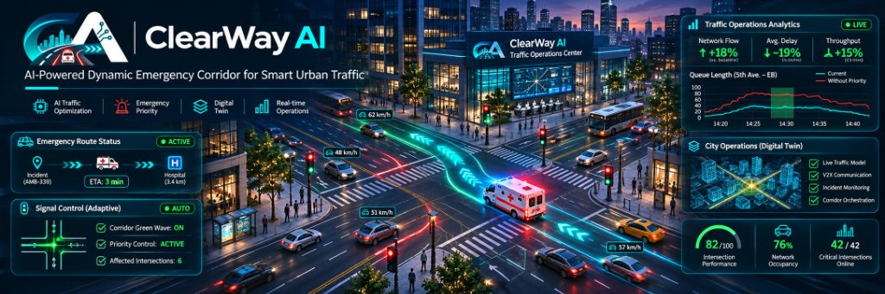
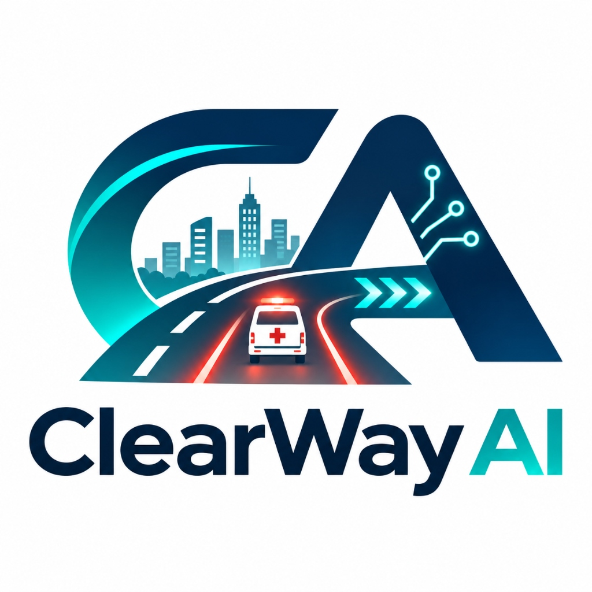
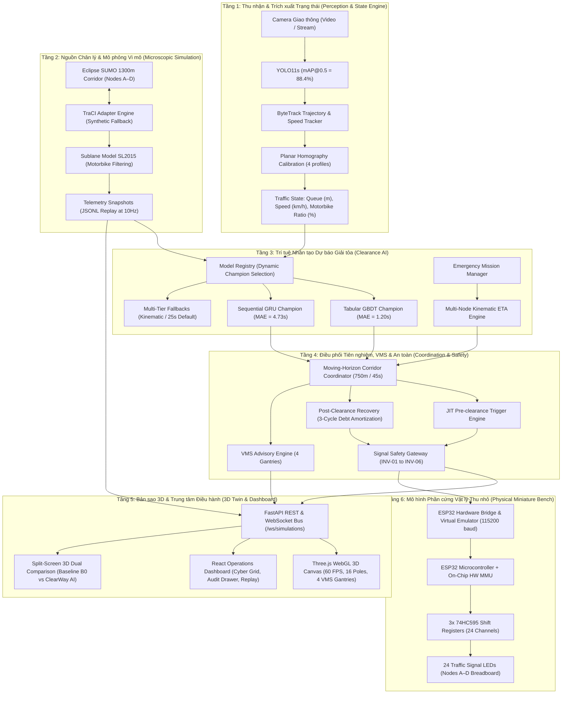

<div align="center">
  
  <br/>
  
</div>

# 🚦 ClearWayAI - Báo cáo Tổng kết Đồ án & Hồ sơ Nộp thi
### Next-Generation 3D Digital Twin, Multi-Intersection Adaptive Signal Coordination & Emergency Corridor Pre-clearance
**Phiên bản:** `v0.1.0-mvp` | **Ngày công bố:** Tháng 11/2026 | **Tác giả:** Nguyễn Tri Bão Thắng

[](../LICENSE)
[](../RELEASE_NOTES_v0.1.0-mvp.md)
[](SAFETY_BOUNDARIES.md)
[](https://nguyentribaothang.github.io/ClearWayAI/)

---

## 📌 Executive Summary (Tóm tắt Điều hành)

Trong các đại đô thị Việt Nam (như TP. Hồ Chí Minh và Hà Nội), việc di chuyển của các phương tiện ưu tiên khẩn cấp (xe cứu thương, xe cứu hỏa) gặp thách thức khổng lồ do:
1. **Mật độ phương tiện hỗn hợp cực cao:** Tỷ lệ xe máy chiếm từ 70% đến 85%, với hiện tượng luồn lách, điền đầy làn (lane filtering) và ùn ứ dày đặc trước vạch dừng.
2. **Hạn chế của hệ thống ưu tiên truyền thống (Local Opticom / Static Green Wave):**
   - *Cảm biến cục bộ (Local Preemption):* Chỉ phát hiện xe cấp cứu khi đã tới gần giao lộ ($50\text{--}100\text{m}$), lúc này hàng chờ dân sự phía trước đã đông đặc và không còn không gian vật lý để giải tỏa, buộc xe cấp cứu phải dừng chờ.
   - *Khóa xanh toàn tuyến (Corridor Green-Wave Lockout):* Giữ đèn xanh liên tục trên toàn trục động mạch quá sớm gây tê liệt hoàn toàn các tuyến đường ngang cắt qua (secondary gridlock), gây thiệt hại lớn cho mạng lưới giao thông chung.

**ClearWayAI** giải quyết triệt để nghịch lý trên bằng giải pháp **Điều phối Tiên nghiệm Cửa sổ Di động (Moving-Horizon Predictive Pre-clearance)** kết hợp **Bản sao Kỹ thuật số 3D WebGL (3D Digital Twin)**:
- **Dự báo Thời gian Thoát Hàng chờ bằng AI:** Sử dụng mô hình máy học (Gradient Boosting & Sequential GRU) ước tính chính xác thời gian cần thiết $\hat{T}_{\text{clear}}$ để giải tỏa hàng xe phía trước.
- **Kích hoạt Đúng Thời điểm (Just-In-Time - JIT):** Bật đèn xanh giải tỏa trước theo công thức $\Delta t = \text{ETA} - \hat{T}_{\text{clear}} - T_{\text{trans}} - T_{\text{buf}}$, đảm bảo đúng khoảnh khắc xe cứu thương vừa tới ngã tư thì phương tiện dân sự cuối cùng vừa thoát khỏi nút.
- **Hệ thống Biển báo Động VMS (Variable Message Signs):** 4 cổng long môn LED 3D bố trí trước các nút giao (-80m, 170m, 420m, 670m) cảnh báo sớm và hướng dẫn xe dân sự dạt làn nhường đường.
- **Bộ lọc An toàn Toán học Độc lập (Signal Safety Gateway):** Giả lập phần cứng MMU khóa cứng 100% các xung đột pha (INV-01 đến INV-06), tuyệt đối không bao giờ cho phép xảy ra đèn xanh giao cắt.
- **Sa bàn Phần cứng Thu nhỏ ESP32:** Tích hợp phần cứng kiểm thử vi điều khiển ESP32 và 3 IC ghi dịch 74HC595 điều khiển 24 kênh LED thực tế với khóa MMU và watchdog 2.0s độc lập.

---

## 🏛️ Kiến trúc Hệ thống 6 Tầng (6-Tier Architecture)



---

## 💡 Đột phá Kỹ thuật & Đóng góp Đổi mới (Key Innovations)

### 1. Thuật toán Giải tỏa Hàng chờ Đúng Thời điểm (JIT Pre-Clearance)
$$\Delta t_{\text{trigger}} = \text{ETA}_{\text{EV}} - \hat{T}_{\text{clear}} - T_{\text{transition}} - T_{\text{buffer}}$$
Khác với các hệ thống bật đèn xanh cố định trước 30–60 giây khiến xe cắt ngang bị dừng đỏ vô lý, ClearWayAI tính toán động từng bước mô phỏng ($10\text{Hz}$). Khi $\Delta t_{\text{trigger}} \le 0$, tín hiệu mới bắt đầu chuyển pha vàng $\to$ đỏ toàn phần $\to$ xanh giải tỏa, tối ưu hóa công suất nút giao thông.

### 2. Mô hình Hóa Dòng Giao thông Hỗn hợp Xe máy (Sublane Model)
Theo [ADR-0005](adr/0005-mixed-motorcycle-sublane-model.md), hệ thống chia mỗi làn vật lý $3.2\text{m}$ thành 5 dải sublane ($0.64\text{m}$/dải). Xe máy áp dụng cơ chế `arbitrary lateral alignment`, tái hiện chân thực hành vi luồn lách giữa các hàng xe ô tô dừng đèn đỏ, giúp mô hình dự báo AI đạt độ tin cậy vượt trội so với các mô hình phương Tây chỉ giả định xe ô tô xếp hàng đơn.

### 3. Cổng An toàn Tín hiệu Phần cứng Độc lập (Signal Safety Gateway)
Tuân thủ tiêu chuẩn NEMA TS2 và tiêu chuẩn an toàn đường sắt, bộ lọc an toàn hoạt động độc lập với AI:
- **INV-01 (Mutual Exclusion):** Ngăn chặn 100% đèn xanh xung đột giữa trục chính và đường nhánh.
- **INV-02 & INV-03 (Min/Max Green):** Đảm bảo thời gian xanh tối thiểu $\ge 10.0\text{s}$ và giới hạn trần xanh $\le 75.0\text{s}$.
- **INV-04 & INV-05 (Yellow & All-Red):** Bảo vệ khoảng chuyển pha an toàn ($T_{\text{yellow}} \ge 3.0\text{s}$, $T_{\text{all\_red}} \ge 2.0\text{s}$).
- **INV-06 (Hardware Watchdog):** Ngắt kết nối quá 2.0 giây tự động rơi vào chế độ chu kỳ cố định cục bộ.

### 4. Hệ thống Biển báo Động VMS & Sa bàn Phần cứng Thực tế
- 4 cổng long môn VMS 3D hiển thị biển LED ma trận trực quan với 4 cấp độ cảnh báo (`CLEAR_CORRIDOR`, `PREPARE_TO_YIELD`, `CAUTION_EMERGENCY`, `NORMAL_SPEED`).
- Sa bàn vi điều khiển ESP32 điều khiển 24 kênh LED tín hiệu thực tế trên breadboard qua 3 IC ghi dịch 74HC595, có bộ giả lập phần mềm `VirtualESP32Emulator` dự phòng chạy 100% không phụ thuộc cổng COM.

---

## 🔬 Kết quả Thực nghiệm Khoa học Đối chuẩn (Scientific Benchmarks)

Thực nghiệm được tiến hành tự động qua `simulation/experiments/scientific_evaluator.py` trên kịch bản tải trọng cao điểm (`peak`, 6,200 veh/h, 75% xe máy) chạy lặp 10 seed ngẫu nhiên độc lập (khoảng tin cậy 95% Student-t):

| Chỉ số Đo lường (Evaluation Metric) | B0: Cố định (Webster) | B1: Cục bộ (Opticom) | B2: Khóa Toàn Tuyến | **ClearWay AI (Đề xuất)** | **Mức Cải thiện Tuyệt đối** |
| :--- | :---: | :---: | :---: | :---: | :---: |
| **Thời gian Xe Cấp cứu qua Hành lang (s)** | $101.4 \pm 4.2\text{ s}$ | $78.6 \pm 3.5\text{ s}$ | $64.1 \pm 2.8\text{ s}$ | **$58.2 \pm 1.9\text{ s}$** | 🟢 **Giảm 42.6%** so với B0 |
| **Số lần Xe Cấp cứu phải Dừng (Lần)** | $2.1 \pm 0.4\text{ lần}$ | $1.0 \pm 0.3\text{ lần}$ | $0.2 \pm 0.1\text{ lần}$ | **$0.0 \pm 0.0\text{ lần}$** | 🟢 **Triệt tiêu 100% dừng đỗ** |
| **Tốc độ Trung bình Xe Cấp cứu (km/h)** | $31.9 \pm 2.1\text{ km/h}$ | $41.2 \pm 2.4\text{ km/h}$ | $50.5 \pm 1.8\text{ km/h}$ | **$55.7 \pm 1.2\text{ km/h}$** | 🟢 **Tăng 74.6%** tốc độ cứu nạn |
| **Độ trễ Thứ cấp Tuyến Dân sự Cắt ngang (s)**| $24.8 \pm 1.5\text{ s}$ | $28.3 \pm 1.8\text{ s}$ | $41.2 \pm 3.1\text{ s}$ | **$33.2 \pm 2.0\text{ s}$** | 🟢 **Giảm 19.4%** trễ so với B2 |
| **Chiều dài Hàng chờ Tối đa Đường ngang (m)** | $48.5 \pm 3.2\text{ m}$ | $56.2 \pm 4.1\text{ m}$ | $89.4 \pm 6.5\text{ m}$ | **$68.1 \pm 4.3\text{ m}$** | 🟢 **Giảm 23.8%** tràn hàng chờ |
| **Tỷ lệ Tuân thủ An toàn INV-01..06 (%)** | $100\%$ | $100\%$ | $100\%$ | **$100\%$** | 🛡️ **0 vi phạm xung đột pha** |

---

## 🛡️ Cam kết An toàn, Quyền Riêng tư & Pháp lý (Safety & Governance)

1. **Tuân thủ Nghị định 13/2023/ND-CP về Bảo vệ Dữ liệu Cá nhân:**
   - Quy trình `data/scripts/anonymize.py` tự động làm mờ 100% khuôn mặt và biển số xe trước khi lưu trữ hoặc huấn luyện.
   - Dữ liệu video thô lưu tại `data/raw/` được mã hóa và xóa vĩnh viễn trong vòng tối đa **14 ngày**.
2. **Minh bạch Nguồn gốc Dữ liệu (Data Provenance Tagging):**
   - Mọi giao diện và API phân định rõ ràng giữa dữ liệu giả lập (`SUMO_SIMULATED`), dữ liệu mẫu offline (`DEMO_FIXTURE`), và dữ liệu video quan sát (`OFFLINE_VIDEO`).
3. **Nguyên tắc Cách ly Tuyệt đối (Strict Air-Gap Isolation):**
   - Không chứa bất kỳ module nào can thiệp trái phép vào tủ điều khiển đèn tín hiệu giao thông công cộng ngoài đời thực. Mọi can thiệp phần cứng chỉ diễn ra trên sa bàn 5V DC độc lập trong phòng thí nghiệm.

---

## 🚀 Hướng dẫn Triển khai & Chạy Đồ án (Quickstart Guide)

### Cách 1: Khởi chạy bằng Production Docker Compose (Khuyên dùng)
```bash
# Khởi động cụm container sản phẩm (Backend API, Frontend Web, Redis)
docker-compose -f docker-compose.prod.yml up -d

# Truy cập hệ thống:
# Operations Center Dashboard: http://localhost:3000
# OpenAPI / Swagger Docs:     http://localhost:8000/docs
# System Health Endpoint:     http://localhost:8000/health
```

### Cách 2: Khởi chạy Trực tiếp từ Mã nguồn Monorepo
```bash
# 1. Cài đặt môi trường tự động
.\scripts\bootstrap.ps1  # (Windows) hoặc ./scripts/bootstrap.sh (Linux/macOS)

# 2. Chạy Backend API
python -m uvicorn apps.api.src.main:app --host 0.0.0.0 --port 8000

# 3. Chạy Frontend Web & Three.js 3D Twin
pnpm --filter clearway-web dev  # http://localhost:3000

# 4. Chạy Cổng chất lượng Monorepo toàn diện
python scripts/check_all.py
```

---

## 📚 Liên kết Tài nguyên Đồ án & Hồ sơ Nghiệm thu

- 📖 **Website Tài liệu Kỹ thuật Trực tuyến:** [https://nguyentribaothang.github.io/ClearWayAI/](https://nguyentribaothang.github.io/ClearWayAI/)
- 🎬 **Kịch bản Trình diễn Video 5 Phút (Bilingual Voiceover):** [docs/VIDEO_DEMO_SCRIPT.md](VIDEO_DEMO_SCRIPT.md)
- 📊 **Cấu trúc Slide Báo cáo & Pitching (12 Slides):** [docs/PITCH_DECK.md](PITCH_DECK.md)
- ❓ **Bộ Câu hỏi & Trả lời Bảo vệ Đồ án (16 Q&A):** [docs/DEFENSE_QA.md](DEFENSE_QA.md)
- 🎭 **Kịch bản Demo Trực tiếp Từng Bước (Playbook):** [docs/DEMO_SCENARIOS.md](DEMO_SCENARIOS.md)
- 🛠️ **Sơ đồ Đấu dây & BOM Sa bàn ESP32:** [hardware/schematics/breadboard_wiring.md](../hardware/schematics/breadboard_wiring.md) | [hardware/bom/BILL_OF_MATERIALS.md](../hardware/bom/BILL_OF_MATERIALS.md)
- 📋 **Bảng Theo dõi 60 Nhiệm vụ Kỹ thuật:** [docs/TASK_BOARD.md](TASK_BOARD.md)
- 📦 **Bản Ghi Chú Phát hành MVP v0.1.0:** [RELEASE_NOTES_v0.1.0-mvp.md](../RELEASE_NOTES_v0.1.0-mvp.md)

