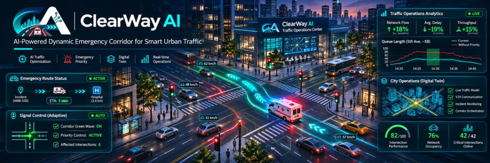

<div align="center">
  
</div>

# ClearWayAI System Requirements Specification (SRS)

> **Document ID:** CW-SPEC-SRS-001  
> **Status:** APPROVED & BASELINED  
> **Version:** 1.0.0  
> **Milestone:** Phase A — Project Initialization & Governance (Task 21)  
> **Safety Classification:** Safety-Critical Intelligent Transportation System (ITS)  

---

## 1. Introduction

### 1.1 Purpose
This document provides the formal **System Requirements Specification (SRS)** for **ClearWayAI** — a Next-Generation 3D WebGL Digital Twin, Multi-Intersection Adaptive Traffic Signal Coordination, and Emergency Vehicle Pre-Clearance Platform designed specifically for high-density, mixed-traffic urban corridors (characterized by high-volume motorcycle flow alongside cars, buses, and emergency response vehicles).

### 1.2 Scope
ClearWayAI bridges microscopic traffic simulation (SUMO), computer vision edge perception (YOLOv8/ByteTrack), reinforcement learning signal arbitration (PPO / Webster), and an interactive 3D WebGL Digital Twin command dashboard. It models and coordinates arterial intersections along an emergency corridor to provide seamless green waves for priority ambulances while minimizing spillback delay on cross streets.

### 1.3 Operational Mode Definitions
To guarantee zero hazard to public traffic infrastructure, ClearWayAI operates under four strictly segregated modes:

| Mode | Identifier | Public Signal Control Permitted | Description |
| :--- | :--- | :---: | :--- |
| **1. Simulation** | `SIMULATION` | **FALSE** | Pure software simulation sandbox using SUMO, synthetic fixtures, and WebGL digital twin. |
| **2. Offline Video** | `OFFLINE_VIDEO` | **FALSE** | Offline perception and tracking benchmark on pre-recorded urban traffic camera datasets. |
| **3. Shadow Advisory** | `SHADOW_ADVISORY` | **FALSE** | Live sensor telemetry ingested in read-only mode; AI decisions logged as advisory recommendations without actuation. |
| **4. Authorized Pilot** | `AUTHORIZED_PILOT` | **RESTRICTED** | Formal municipal pilot requiring multi-signature hardware physical authorization keys and hardwired MMU interlock. |

---

## 2. Functional Requirements (FR)

### FR-01: Multi-Modal Vehicle Detection & Classification
- **FR-01.1:** The system shall detect and classify 7 distinct vehicle classes in urban traffic: `motorcycle`, `car`, `suv`, `bus`, `truck`, `ambulance`, and `fire_engine`.
- **FR-01.2:** The vision pipeline shall achieve $\ge 85\%$ mAP@0.5 on Vietnamese mixed motorcycle traffic datasets.
- **FR-01.3:** Object tracking via ByteTrack shall maintain persistent vehicle IDs across consecutive frames with an ID switch rate $< 3\%$.

### FR-02: Microscopic Traffic Simulation (SUMO)
- **FR-02.1:** The system shall interface with Eclipse SUMO via TraCI/libsumo across a 4-intersection corridor (Nodes A–D: INT-0455 to INT-0458).
- **FR-02.2:** The simulation shall employ the SUMO sublane model (`laneChangeModel="SL2015"`) to capture lateral filtering, swarming, and creeping behaviors of Vietnamese motorcycles.
- **FR-02.3:** The simulation shall support real-time step execution, single-step inspection, and deterministic snapshot replay.

### FR-03: Interactive 3D WebGL Digital Twin
- **FR-03.1:** The frontend shall render a real-time, interactive 3D WebGL Digital Twin of intersection INT-0457 using Three.js.
- **FR-03.2:** The 3D viewport shall provide bounded isometric OrbitControls, camera presets (`ISO`, `TOP`, `CLOSE`, `CHASE`), and dual perspective/orthographic projection.
- **FR-03.3:** The 3D scene shall render 4-aspect signal poles with mutual exclusion lens shaders, road markings (crosswalks, arrows, stop lines), contextual urban buildings, and vehicle models.
- **FR-03.4:** Static background raster images shall be strictly forbidden as cheats; all 3D kinematics shall be synthesized from geometric meshes.

### FR-04: Emergency Corridor Pre-Clearance
- **FR-04.1:** Upon dispatch of an emergency mission (`AMB-339`), the system shall calculate estimated time of arrival (ETA) to each downstream intersection.
- **FR-04.2:** The pre-clearance coordinator shall transition approaching signals into a green wave hold, draining queued cross-traffic prior to emergency vehicle arrival.
- **FR-04.3:** Immediately following emergency vehicle egress, signals shall transition to a smooth recovery phase, redistributing green splits to clear accumulated cross-street queues.

### FR-05: Adaptive Signal Phase Arbitration & Split Timing
- **FR-05.1:** The system shall support both fixed-time baseline, actuated (Webster), and reinforcement learning (PPO) signal timing policies.
- **FR-05.2:** Signal coordination shall conform to the NEMA TS2 ring-barrier standard with dual concurrent rings and 8 distinct vehicular phases.
- **FR-05.3:** Phase splits and cycle times shall be exposed through the Top-Middle Approach Split Timing Table (`PhaseTimingPanel`).

### FR-06: Independent Malfunction Management Unit (MMU) Safety Interlock
- **FR-06.1:** An independent software and simulated hardware MMU gateway shall inspect every signal state transition before publication.
- **FR-06.2:** If conflicting greens or yellows are ever commanded concurrently on opposing approaches, the MMU shall reject the command and force an immediate fail-safe All-Red flash state.
- **FR-06.3:** The safety interlock shall enforce minimum green $\ge 10.0\text{ s}$, maximum green $\le 75.0\text{ s}$, yellow change $\ge 3.0\text{ s}$, and all-red clearance $\ge 2.0\text{ s}$.

### FR-07: V2I / V2X Telemetry Gateway
- **FR-07.1:** The system shall model a 4-stage hardware pipeline: `Vehicle (OBU) ➔ RSU ➔ Edge Controller ➔ Signal Controller`.
- **FR-07.2:** Channel diagnostics shall report link status, latency jitter, packet loss percentage, and RF carrier band (5.9 GHz DSRC / C-V2X).
- **FR-07.3:** If communication latency exceeds $500\text{ ms}$ or link disconnects, edge controllers shall autonomously fall back to local inductive loop timing.

### FR-08: Operations Analytics & Performance Benchmarking
- **FR-08.1:** The system shall track real-time hourly volume (veh/h) across all 4 approaches (NB, SB, EB, WB) with 15-minute moving average baselines.
- **FR-08.2:** The system shall compute zone travel times and calculate relative delay reductions vs. fixed-time pretimed baselines.
- **FR-08.3:** The system shall render a circular Radial Performance Gauge displaying the composite Performance Index ($82 / 100$) alongside throughput, delay, and stop deltas.

### FR-09: IoT Sensor Network & City Vector Map
- **FR-09.1:** The system shall track sensor availability across 5 categories: Traffic Cameras (112), LiDAR Sensors (48), Loop Detectors (96), RSUs (42), and Signal Controllers (8).
- **FR-09.2:** An interactive vector SVG city map shall visualize the arterial street grid, corridor routing, intersection nodes, hospital facility, compass rose, and metric scale bar.
- **FR-09.3:** Operators shall be able to dynamically toggle 6 city data layers: Traffic Flow, Sensor Coverage, V2X Network, Incident/Event, Emergency Corridor, and Parking Occupancy.

### FR-10: Operational Controls, Mission Drawer & Unified Inspector
- **FR-10.1:** The dashboard shall provide floating simulation playback controls (Play, Pause, Step, Reset, Speed multipliers 0.5x–5x, and scenario selection).
- **FR-10.2:** The Mission Drawer shall allow operators to monitor live emergency response missions, view countdowns, and toggle corridor pre-emption.
- **FR-10.3:** The Unified Inspector shall allow on-demand telemetry inspection of vehicles, signal poles, sensors, and intersection nodes with JSON export.

---

## 3. Non-Functional Requirements (NFR)

### NFR-01: Control Loop Latency
- The end-to-end telemetry ingestion, inference, and signal arbitration cycle shall complete within $\le 250\text{ ms}$ at 10 Hz refresh rates.

### NFR-02: 3D Rendering Performance Budget
- The 3D Digital Twin shall maintain $\ge 55\text{ FPS}$ (target 60 FPS) on standard client hardware with frame render times $\le 8.0\text{ ms}$, draw calls $\le 60$, and triangle count $\le 25,000$.

### NFR-03: Safety Interlock Reliability
- The safety interlock conflict monitoring matrix shall have zero false-negative bypasses ($100\%$ detection of conflicting right-of-way commands).

### NFR-04: Data Privacy & Ethics
- All public camera feeds used for video benchmarks shall undergo automated facial and license plate de-identification before model training or digital twin visualization.

### NFR-05: Honest Provenance Gating
- Every dashboard card, telemetry API response, and 3D overlay shall prominently display its data provenance (`DEMO_FIXTURE`, `SUMO_SIMULATED`, `OFFLINE_VIDEO`, `SHADOW_ADVISORY`). No mock data shall ever masquerade as real-world live traffic.

### NFR-06: Monorepo Architecture & Cross-Platform Support
- All services, apps, and documentation shall reside in a unified monorepo executable via Docker Compose across Windows, macOS, and Linux.

---

## 4. System Boundaries & Interfaces

```
+-----------------------------------------------------------------------------------+
|                                  OPERATOR CONSOLE                                 |
|   +-----------------------+ +--------------------+ +--------------------------+   |
|   | 3D Digital Twin (Web) | | Cyber Panels (Web) | | Mission Drawer / Controls|   |
|   +-----------------------+ +--------------------+ +--------------------------+   |
+-----------------------------------------^-----------------------------------------+
                                          | WebSocket / REST API (:8000)
+-----------------------------------------v-----------------------------------------+
|                                CLEARWAY AI BACKEND                                |
|   +-------------------+  +-----------------------+  +-------------------------+   |
|   |  FastAPI Gateway  |  | TraCI Simulation Mgr  |  | Emergency State Machine |   |
|   +-------------------+  +-----------------------+  +-------------------------+   |
|             |                        |                           |                |
|             v                        v                           v                |
|   +---------------------------------------------------------------------------+   |
|   |          INDEPENDENT SAFETY INTERLOCK & MMU CONFLICT GATEWAY              |   |
|   +---------------------------------------------------------------------------+   |
+-----------------------------------------^-----------------------------------------+
                                          |
                      +-------------------+-------------------+
                      |                                       |
           +----------v-----------+               +-----------v----------+
           |     SUMO ENGINE      |               |  EDGE COMPUTER VISION |
           |  Microscopic Net A-D |               |  YOLOv8 + ByteTrack  |
           +----------------------+               +----------------------+
```

