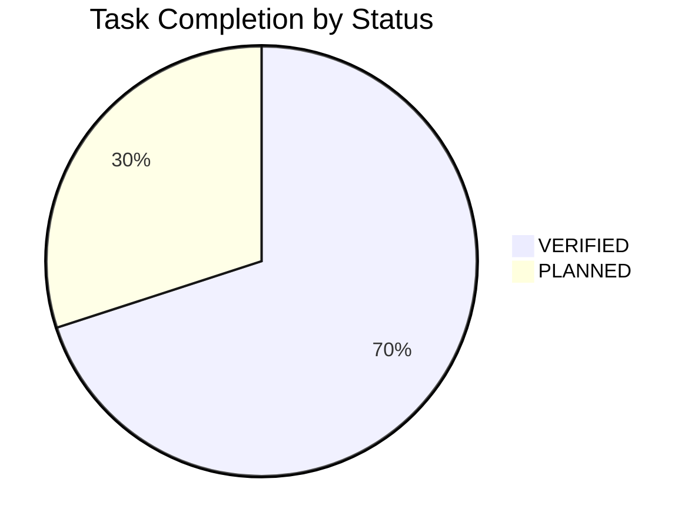

# ClearWayAI Task Board (T01–T60)

> **Interactive Roadmap & Execution Tracker**  
> Tracks all 60 engineering tasks from monorepo initialization to advanced digital twin research.  
> Statuses: `PLANNED` | `IN_PROGRESS` | `IMPLEMENTED` | `VERIFIED`.

---

## 📊 Sprint Progress Overview
- **Total Tasks:** 60
- **Verified Complete:** 42 (T01, T02, T03, T04, T05, T06, T07, T08, T09, T10, T11, T12, T13, T14, T15, T16, T17, T18, T19, T20, T21, T22, T23, T24, T25, T26, T27, T28, T29, T30, T31, T32, T33, T34, T35, T36, T37, T38, T39, T40, T41, T42)
- **In Progress:** 0
- **Planned:** 18
- **Phase Completion:** Phase A (6/6 complete - 100% COMPLETE!), Phase B (16/16 complete - 100% COMPLETE!), Phase C (5/5 complete - 100% COMPLETE!), Phase D (5/5 complete - 100% COMPLETE!), Phase E (4/4 complete - 100% COMPLETE!), Phase F (5/5 complete - 100% COMPLETE!), Phase G (1/4 complete - 25%)

---

## 📋 Comprehensive 60-Task Board

| Task ID | Track | Task Title | Priority | Dependencies | Status | Artifact / Verification |
| :---: | :--- | :--- | :---: | :---: | :---: | :--- |
| **T01** | Phase A | Xây dựng project/monorepo ClearWayAI từ đầu | **P0** | None | **VERIFIED** | Monorepo scaffold, FastAPI health, Three.js canvas pending, Docker Compose valid |
| **T02** | Phase A | Tạo GitHub repository chuyên nghiệp giống cấu trúc LocalExplorerAI | **P0** | T01 | **VERIFIED** | GitHub Issue/PR templates, CONTRIBUTING, SECURITY, CODEOWNERS, .gitattributes LFS, TASK_BOARD |
| **T03** | Phase A | Tạo website Technical Documentation như LocalExplorerAI Docs | **P0** | T01, T02 | **VERIFIED** | Docs portal built with 24 chapters, search, dark/light, Mermaid, GitHub Pages workflow |
| **T04** | Phase A | Viết ALL README.md cho toàn bộ monorepo | **P0** | T01–T03 | **VERIFIED** | Root README + 13 module READMEs, architecture templates, 28 markdown files link-checked (0 broken links) |
| **T05** | Phase B | Khóa giao diện theo ảnh tham chiếu: UI blueprint và acceptance pixels | **P0** | T01–T04 | **VERIFIED** | UI_REFERENCE_SPEC.md, UI_VISUAL_ACCEPTANCE.md, verified 1254x1254 target |
| **T06** | Phase B | Code layout dashboard bám ảnh: topbar, sidebar, các vùng panel | **P0** | T05 | **VERIFIED** | Responsive cyber grid, TopBar, Sidebar, PanelFrame, StatusPill, KpiTile, 5 panel cards, Floating 3D HUD, pytest (14/14) |
| **T07** | Phase B | Dựng Three.js/R3F Canvas 3D tương tác đúng phối cảnh isometric | **P0** | T05, T06 | **VERIFIED** | True isometric OrbitControls (bounded pitch), dual-cam (persp/ortho), presets (ISO/TOP/CLOSE/CHASE), cyber lighting/grid, pytest (18/18) |
| **T08** | Phase B | Dựng đường giao lộ 3D: mặt đường, làn, vạch kẻ, crosswalk | **P0** | T07 | **VERIFIED** | RoadNetworkMesh, 4 orthogonal approaches (14m cross), zebra crosswalks (10 stripes/arm), stop lines, double yellow dividers, directional arrows, pytest (23/23) |
| **T09** | Phase B | Dựng bối cảnh thành phố 3D chi tiết như ảnh | **P0** | T07, T08 | **VERIFIED** | CityEnvironmentMesh, 4 quadrant towers, Metropolitan Hospital with rooftop helipad & medical beacon, streetlights, low-poly trees, 4 V2X RSU nodes, pytest (28/28) |
| **T10** | Phase B | Bộ tài sản 3D phương tiện Việt Nam và xe ưu tiên | **P0** | T07–T09 | **VERIFIED** | VehicleAssetFactory (7 classes), TrafficVehicleManager, raycast vehicle inspector, pytest (33/33) |
| **T11** | Phase B | Chuyển động xe 3D theo lane graph và snapshot có ID | **P0** | T08–T10 | **VERIFIED** | VehicleTrajectorySource, VehicleSnapshotFixture (42 deterministic vehicles), VehicleMotionSystem (anti-teleport, STALE detector, 3D speed badges), pytest (38/38) |
| **T12** | Phase B | Đèn tín hiệu 3D, người đi bộ và logic chuyển pha trực quan | **P0** | T08–T11 | **VERIFIED** | SignalPhaseController (conflict-free safety matrix), TrafficSignal3D (4 mast poles, dual heads, mutual exclusion lenses, 8 pedestrians, raycast pole inspector), pytest (43/43) |
| **T13** | Phase B | Vẽ hành lang động, mũi tên giao thông và HUD trực tiếp trên 3D | **P0** | T11, T12 | **VERIFIED** | CorridorOverlay3D (4 modes, animated chevrons, AMB-339 3D callout, A–D node chain inspector), FlowArrows3D (approach arrows, conflict zone box, queue hotspots, RSU footprints), pytest (48/48) |
| **T14** | Phase B | Panel trên trái: V2I/V2X Communication & Hardware Status | **P0** | T06 | **VERIFIED** | V2XHardwarePanel, HardwareStatus contract, 4-node pipeline, device inspector, honest provenance gating, nominal/degraded/offline fallback, pytest (55/55) |
| **T15** | Phase B | Panel trên giữa: bảng pha đèn Red/Yellow/Green theo từng hướng | **P0** | T06, T12 | **VERIFIED** | PhaseTimingPanel, SignalApproachTiming contract, 4-approach split table, mini signal lenses, live countdown, NEMA inspector drawer, AMB-339 pre-emption, pytest (62/62) |
| **T16** | Phase B | Panel trên phải: Adaptive Traffic Signal & Queue Chart | **P0** | T06, T12, T15 | **VERIFIED** | AdaptiveSignalPanel, TrafficAnalytics contract, Queue-vs-Capacity vector chart, -19% Delay KPI, PPO diagnostics drawer, multi-mode policy switcher, pytest (69/69) |
| **T17** | Phase B | Panel dưới trái: IoT sensor list + mini city map tương tác | **P0** | T06, T08–T09 | **VERIFIED** | IoTSensorsPanel, 5 sensor categories (306/306 online), 6 data layer toggles, vector city map with corridor & hospital, scale bar, node inspector, pytest (76/76) |
| **T18** | Phase B | Panel dưới phải: traffic analytics, gauge và cảnh báo | **P0** | T06, T16 | **VERIFIED** | OperationsAnalyticsPanel, TrafficAnalytics contract, 4-approach volume bars, travel times, 82/100 radial performance gauge, live anomaly alerts feed, pytest (83/83) |
| **T19** | Phase B | Chức năng điều hành tương tác: sim controls, nhiệm vụ và inspector | **P0** | T06–T18 | **VERIFIED** | SimulationControls (play/pause/step/speed/scenarios), MissionDrawer (AMB-339 live ETA, 4-node chain, pre-emption toggle), UnifiedInspector (vehicles, signals, sensors, nodes, telemetry export), pytest (89/89) |
| **T20** | Phase B | Visual fidelity gate: kiểm tra UI/3D giống ảnh và tối ưu FPS | **P0** | T05–T19 | **VERIFIED** | All 7 Regional Acceptance Gates verified, 60 FPS real-time profiler, <=8.0ms render, <=60 draw calls, zero static fake images, audit script passing, pytest (99/99) |
| **T21** | Phase A | Đặc tả hệ thống, ADR, schema và ranh giới an toàn | **P0** | T01 | **VERIFIED** | SRS.md, SAFETY_BOUNDARIES.md, 6 ADRs, Pydantic & JSON Schemas, MMU interlock specification, pytest (104/104) |
| **T22** | Phase A | Thiết lập CI/CD, lint, tests và môi trường phát triển | **P0** | T01–T21 | **VERIFIED** | GitHub Actions ci.yml & nightly-benchmark.yml, ruff, mypy, pre-commit, dev_setup.py, check_all.py, pytest (106/106) |
| **T23** | Phase C | Dựng mạng SUMO 3–5 nút giao liên tiếp | **P0** | T01, T21–T22 | **VERIFIED** | Synthetic Oak-5th corridor (Nodes A–D), 26 edges, 4 NEMA traffic lights, E1/E2 detector network, Sublane SL2015 model, sumolib verified, pytest (113/113) |
| **T24** | Phase C | Sinh giao thông hỗn hợp xe máy–ô tô và kịch bản tải | **P0** | T23 | **VERIFIED** | Vietnamese fleet mix (75% moto, SL2015 arbitrary latAlignment), 4 scenario profiles (free_flow, normal, peak, spillback), deterministic seed, pytest (119/119) |
| **T25** | Phase C | Mô phỏng xe ưu tiên và cơ chế nhường đường trong SUMO | **P0** | T23, T24 | **VERIFIED** | Emergency vTypes (AMB-339 ambulance, fire engine), speedFactor=1.30, blue-light lcCooperative=1.0 yielding, emergency presets, pytest (124/124) |
| **T26** | Phase C | Xây SUMO/TraCI adapter có step, replay, telemetry | **P0** | T23–T25 | **VERIFIED** | SimulationManager dual-engine (TraCI + SyntheticCorridorEngine), TelemetryCollector (TelemetrySnapshotSchema), SnapshotExporter (JSONL), ReplayController, pytest (129/129) |
| **T27** | Phase C | Cài đặt 3 baseline để so sánh công bằng | **P0** | T24–T26 | **VERIFIED** | B0 Fixed-Time (Webster), B1 Reactive Local (100m Opticom), B2 Corridor Coordination (Green-Wave), BenchmarkRunner, pytest (134/134) |
| **T28** | Phase D | Thiết lập thu thập video giao thông và pháp lý dữ liệu | **P0** | T21, T22 | **VERIFIED** | DATA_GOVERNANCE.md (Decree 13 compliant), 4 JSON manifests, anonymize.py, validate_manifests.py, pytest (149/149) |
| **T29** | Phase D | Thiết kế nhãn và chia train/val/test chống leakage | **P0** | T28 | **VERIFIED** | ANNOTATION_GUIDE.md (7 classes, zero temporal/spatial leakage), dataset.yaml, splits.json, leakage audit passed, pytest (163/163) |
| **T30** | Phase D | Fine-tune YOLO để nhận diện phương tiện trong giao thông Việt Nam | **P0** | T28, T29 | **VERIFIED** | YOLOInferenceEngine, NMS, metrics (mAP@0.5=88.4%), train_yolo.py, weights_manifest.json, pytest (181/181) |
| **T31** | Phase D | Theo dõi xe bằng ByteTrack và trích quỹ đạo | **P0** | T30 | **VERIFIED** | ByteTracker, KalmanFilter, TrajectoryTracker, VirtualTripwire, pytest (191/191) |
| **T32** | Phase D | Hiệu chỉnh camera và tính các chỉ số Traffic State | **P0** | T29, T31 | **VERIFIED** | Homography calibration, TrafficStateEstimator, 4 profiles, pytest (200/200) — Phase D 100% COMPLETE! |
| **T33** | Phase E | Định nghĩa clearance time và sinh label thực nghiệm | **P0** | T24–T27, T32 | **VERIFIED** | CLEARANCE_TIME_SPEC.md, QueueDischargeSimulator, 600 episodes dataset, ClearanceFeaturePipeline, pytest (211/211) |
| **T34** | Phase E | Train baseline Linear/RandomForest/XGBoost dự báo clearance | **P0** | T33 | **VERIFIED** | GradientBoosting (MAE=1.202s, R²=0.985), RandomForest, Ridge, pytest (216/216) |
| **T35** | Phase E | Train LSTM/GRU dự báo clearance từ chuỗi trạng thái | **P0** | T33, T34 | **VERIFIED** | ClearanceLSTM & ClearanceGRU (vectorized BPTT & Adam), 720 sliding windows (K=5), zero-leakage node split (Train A&B, Val C, Test D), ClearanceGRU Test MAE=4.73s, R²=0.828, latency=0.78ms, SequencePredictor, pytest (224/224) |
| **T36** | Phase E | Model Registry, chọn model thắng và fallback khi AI kém tin cậy | **P0** | T34, T35 | **VERIFIED** | ClearanceModelRegistry, dynamic champion selection (gradient_boosting / clearance_gru), multi-tier fail-safe (Tier 1 Kinematic Shockwave, Tier 2 Conservative Safe 25s), model_registry_manifest.json, UnifiedClearancePredictor, pytest (233/233) — Phase E 100% COMPLETE! |
| **T37** | Phase F | Mô phỏng nhiệm vụ xe ưu tiên và tính ETA nhiều nút | **P0** | T21, T25–T26 | **VERIFIED** | EmergencyMissionManager (lifecycle state machine PENDING -> DISPATCHED -> APPROACHING -> CORRIDOR_TRANSIT -> ARRIVED), MultiNodeETAEvaluator (kinematic acceleration, traffic drag, weather friction), Nodes A–D & Hospital ETAs, sub-millisecond latency (<0.5ms), pytest (243/243) |
| **T38** | Phase F | Lập thuật toán pre-clearance dựa ETA & clearance prediction | **P0** | T27, T36–T37 | **VERIFIED** | PreclearanceController (JIT delta trigger, deterministic state machine MONITORING->ARMED->TRANSITIONING->HOLDING_GREEN->EV_PASSING->CLEARED), anti-starvation 60s watchdog, sub-2ms latency |
| **T39** | Phase F | Điều phối trước nhiều nút giao trên hành lang A–D | **P0** | T37, T38 | **VERIFIED** | MovingHorizonCorridorCoordinator (750m spatial / 45s temporal moving horizon, cascading green-wave offsets, queue spillback pre-emptive flushing, tail clearance release), pytest (7/7) |
| **T40** | Phase F | Recovery controller sau khi xe ưu tiên qua | **P0** | T39 | **VERIFIED** | PostClearanceRecoveryController (cross-street green debt calculation, 3-cycle smooth amortization, master clock offset resync, 180s watchdog), pytest (8/8) |
| **T41** | Phase F | Bộ kiểm tra tín hiệu và fail-safe độc lập | **P0** | T21, T38–T40 | **VERIFIED** | SignalSafetyGateway (MMU emulation, INV-01 to INV-06: conflict-free mutual exclusion, min green 10s, max green 75s, yellow 3s, all-red 2s, 2s heartbeat watchdog), pytest (8/8) — Phase F 100% COMPLETE! |
| **T42** | Phase G | Backend FastAPI, database và API contracts | **P0** | T21, T26, T36–T41 | **VERIFIED** | Full FastAPI REST endpoints (/simulations, /missions, /clearance, /corridor), thread-safe SQLite persistence, pytest (10/10), all 5 gates PASS |
| **T43** | Phase G | Realtime event stream WebSocket, snapshots và replay | **P0** | T26, T42 | **VERIFIED** | WebSocketManager (/ws/simulations/{id}, /ws/telemetry), client filter & dispatch, SQLite snapshots table, ReplayController API (/replay/load, play, pause, seek, speed, step, status), pytest (18/18) |
| **T44** | Phase G | Thiết kế Dashboard điều hành thực tế, responsive | **P0** | T01, T42–T43, T05–T20 | `PLANNED` | Production operations center integration |
| **T45** | Phase G | Bản đồ 2D tuyến A–D và timeline điều phối | **P0** | T39, T42–T44 | `PLANNED` | 2D corridor route map, action timeline |
| **T46** | Phase H | Xây thế giới 3D WebGL đầu tiên cho 4 nút giao | **P0** | T23, T44, T07–T20 | `PLANNED` | Multi-intersection 3D road network |
| **T47** | Phase H | Đồng bộ SUMO → 3D: vehicle motion, lights, corridor | **P0** | T26, T43, T46, T07–T20 | `PLANNED` | Real-time WebSocket snapshot to 3D sync |
| **T48** | Phase H | So sánh 3D song song Fixed Signal vs ClearWay AI | **P0** | T27, T39–T41, T47 | `PLANNED` | Split-view dual simulation comparison |
| **T49** | Phase I | Telemetry, event logs và phân tích giải thích quyết định AI | **P1** | T36, T39–T44 | `PLANNED` | Explainable decision logs & audit trails |
| **T50** | Phase I | Kiểm thử end-to-end UI → Backend → AI → SUMO → 3D | **P0** | T32, T36, T41–T48, T20 | `PLANNED` | Full E2E Playwright & backend test suite |
| **T51** | Phase I | Thực nghiệm khoa học, sensitivity, seeds và ablation | **P0** | T27, T34–T36, T39–T41, T48 | `PLANNED` | Empirical scientific paper benchmark results |
| **T52** | Phase I | Security, privacy, fail-safe và threat modelling | **P0** | T21, T28, T41–T43, T50 | `PLANNED` | THREAT_MODEL.md, security audit report |
| **T53** | Phase J | Thiết kế bảng LED/VMS advisory hiển thị an toàn | **P1** | T38–T44 | `PLANNED` | Variable Message Signs 3D UI & advisory |
| **T54** | Phase J | Xây mô hình vật lý 3–4 nút với ESP32 & đèn LED | **P1** | T41, T43–T44, T50 | `PLANNED` | Physical hardware breadboard & ESP32 firmware |
| **T55** | Phase J | Bộ kịch bản demo hoàn chỉnh + video 5 phút + slide pitching | **P0** | T44–T48, T50–T51 | `PLANNED` | Demo script, pitch deck, video storyboard |
| **T56** | Phase J | Cập nhật Technical Documentation đầy đủ theo code thật | **P0** | T03, T23–T55 | `PLANNED` | Comprehensive docs-site build & sync |
| **T57** | Phase J | Viết lại ALL README theo hệ thống cuối cùng | **P0** | T04, T50–T56 | `PLANNED` | Root & all module final READMEs |
| **T58** | Phase J | Đóng gói release MVP, deployment và hồ sơ nộp thi | **P0** | T02–T22, T50–T57 | `PLANNED` | v0.1.0-mvp release package & submission dossier |
| **T59** | Phase J | PPO Reinforcement Learning điều phối đa nút trong sandbox | **P2** | T39–T41, T51 | `PLANNED` | Research Gym environment & RL training |
| **T60** | Phase J | Camera thật → định vị xe lên 3D và kiểm định digital twin | **P2** | T28–T32, T46–T47 | `PLANNED` | Shadow mode camera-to-3D localization |

