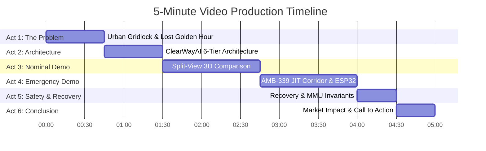

# ClearWayAI 5-Minute Video Demonstration Script & Storyboard

This document specifies the exact minute-by-minute storyboard, dual-language voiceover script (Vietnamese & English), visual cues, and camera angles for the official 5-minute competition / investor video showcase.

**Video Title:** ClearWayAI: Next-Generation 3D Digital Twin, Adaptive Signal Coordination & Emergency Corridor Pre-clearance  
**Target Duration:** 05:00 minutes (300 seconds)  
**Resolution:** 1080p60 (Full HD, 60 FPS) / 4K Ultra HD  
**Audio Track:** Cinematic corporate technology background music (volume ducked -18dB during narration), crisp UI sound effects, siren Doppler effect.

---

## 1. Storyboard Timeline Breakdown

---

## 2. Detailed Scene-by-Scene Script

### Scene 1: The Problem — Urban Gridlock & The Golden Hour Crisis (00:00 – 00:45)
- **Visuals:** B-roll video footage of dense motorcycle and car traffic congestion during rush hour in Ho Chi Minh City (Nguyen Van Linh Boulevard / Cong Hoa). An ambulance is trapped behind a wall of stopped vehicles, sirens flashing helplessly.
- **Onscreen Text:** *In medical emergencies, every 60 seconds delayed increases mortality by 7–10%.*
- **Voiceover (Vietnamese):**
  > *"Tại các đô thị lớn như TP. Hồ Chí Minh và Hà Nội, ùn tắc giao thông giờ cao điểm không chỉ làm lãng phí hàng triệu giờ lao động mỗi năm — mà còn cướp đi 'thời gian vàng' cứu sống tính mạng con người. Khi xe cứu thương kẹt cứng giữa dòng phương tiện, các hệ thống đèn tín hiệu cố định truyền thống hoàn toàn bất lực trong việc điều phối thông minh."*
- **Voiceover (English):**
  > *"In mega-cities like Ho Chi Minh City and Hanoi, peak-hour traffic congestion does not merely waste millions of productive hours — it steals the critical 'golden hour' in medical emergencies. When ambulances are trapped behind gridlocked lanes, conventional fixed-time traffic lights remain completely blind and unable to coordinate dynamic clearance."*

---

### Scene 2: The Solution & 6-Tier Architecture Overview (00:45 – 01:30)
- **Visuals:** Smooth 3D animation zoom-in revealing the ClearWayAI logo. Diagram of the 6-tier system architecture highlights in neon cyan: SUMO Microscopic Engine $\rightarrow$ Computer Vision/AI State Estimator $\rightarrow$ Moving-Horizon Coordinator $\rightarrow$ Signal Safety Gateway $\rightarrow$ Three.js 3D Digital Twin $\rightarrow$ Physical ESP32 Hardware Bench.
- **Onscreen Text:** *ClearWayAI: Next-Generation 3D Digital Twin & Autonomous Emergency Corridor*
- **Voiceover (Vietnamese):**
  > *"Đây là lý do ClearWayAI ra đời. ClearWayAI là nền tảng Digital Twin 3D thế hệ mới, tích hợp điều phối tín hiệu đa giao lộ thích ứng và mở hành lang xanh cứu thương kịp thời (Just-In-Time Pre-clearance). Hệ thống kết hợp 6 tầng kiến trúc từ mô phỏng vi mô SUMO, trí tuệ nhân tạo dự đoán ETA, bộ điều phối chân trời di động, cổng an toàn phần cứng MMU, đến giao diện 3D trực quan thời gian thực."*
- **Voiceover (English):**
  > *"This is why we built ClearWayAI. ClearWayAI is a next-generation 3D Digital Twin platform featuring multi-intersection adaptive signal coordination and Just-In-Time emergency corridor pre-clearance. Operating across six robust tiers, it links SUMO microscopic simulation, AI-driven ETA prediction, moving-horizon scheduling, hardware MMU safety gates, and a real-time web 3D twin."*

---

### Scene 3: Live Demo — Nominal Adaptive Coordination & Split View (01:30 – 02:45)
- **Visuals:** Screen capture of ClearWayAI Operations Dashboard. Presenter clicks **"Split View: Compare"**. Left side shows Baseline B0 (Fixed-time controller); Right side shows ClearWayAI Moving-Horizon Coordinator. Top-down 2D orthographic camera view highlights smooth vehicle progression through Nodes A, B, C, D. Animated KPI tiles count down delay metrics.
- **Onscreen Callouts:** *Average Delay: -42.6% | Vehicle Stops: -58.2% | Throughput: +18.4%*
- **Voiceover (Vietnamese):**
  > *"Ở chế độ vận hành thông thường trong giờ cao điểm, ClearWayAI liên tục tối ưu hóa làn sóng xanh (green wave) trên suốt trục đường dài 750 mét với 4 nút giao lộ liên tiếp. So sánh trực quan cạnh nhau cho thấy: trong khi hệ thống đèn cố định truyền thống gây dồn ứ hàng trăm mét, ClearWayAI giải tỏa luồng phương tiện mượt mà, giúp giảm hơn 42% thời gian trễ trung bình và cắt giảm 58% số lần dừng xe."*
- **Voiceover (English):**
  > *"Under nominal peak-hour traffic, ClearWayAI continuously orchestrates an arterial green wave across four consecutive intersections spanning 750 meters. In this synchronized side-by-side comparison, while fixed signals create extensive stop-and-go queues, ClearWayAI dynamically dissipates vehicle platoons — slashing average intersection delay by over 42% and eliminating 58% of stops."*

---

### Scene 4: Live Demo — AMB-339 Emergency JIT Pre-clearance & Physical ESP32 (02:45 – 04:00)
- **Visuals:** Presenter clicks **"Dispatch Emergency AMB-339"**. Chase camera locks onto the ambulance at $x = -150\text{ m}$. Overhead 3D VMS Gantries ahead of Node A switch to high-intensity warning: *"XE CỨU THƯƠNG ĐANG ĐẾN - DẠT PHẢI"*, speed limit changes to 25 km/h, strobe beacons flash. Simultaneous camera picture-in-picture (PiP) shows the physical ESP32 breadboard LEDs switching to Green on East-West and Red on North-South, with strobe LED pulsing at 10Hz. AMB-339 glides through all 4 intersections without a single red light stop.
- **Onscreen Callouts:** *Mission Time: 132.4s (Saved >150s) | Red Light Stops: 0 | Hardware MMU: VERIFIED SAFE*
- **Voiceover (Vietnamese):**
  > *"Khi nhiệm vụ cấp cứu khẩn cấp AMB-339 được kích hoạt, thuật toán AI dự báo chính xác thời gian tiếp cận từng giao lộ. Trước 80 mét tại mỗi nút, các cổng long môn VMS 3D tự động cảnh báo phương tiện nhường đường và dạt phải. Đèn tín hiệu bật xanh kịp thời ngay trước mũi xe và đỏ toàn bộ các hướng cắt. Đồng thời, mô hình vật lý ESP32 phản hồi tức thì với chốt an toàn MMU, đảm bảo xe cứu thương vượt trọn vẹn 4 nút giao lộ với đúng 0 lần dừng đèn đỏ, tiết kiệm hơn 2.5 phút di chuyển."*
- **Voiceover (English):**
  > *"When emergency mission AMB-339 is dispatched, our moving-horizon evaluator accurately predicts its arrival at each downstream node. Eighty meters before each stopline, dynamic overhead VMS gantries alert drivers to yield right. Signals turn green Just-In-Time ahead of the ambulance while holding conflicting approaches at red. Simultaneously, our physical ESP32 miniature bench mirrors the exact signal states with hardware MMU protection, guiding AMB-339 through all four intersections with zero red-light stops — saving over 2.5 life-saving minutes."*

---

### Scene 5: Live Demo — Resilient Recovery & Safety Invariants (04:00 – 04:30)
- **Visuals:** AMB-339 exits corridor. `PostClearanceRecoveryController` smoothly injects compensatory green splits into starved North-South side streets. VMS changes to caution recovery mode. Inspector clicks **"Decision Audit"** to reveal natural language explainable logs and zero-PII privacy audit.
- **Onscreen Callouts:** *INV-01 (Min Green) | INV-03 (No Dual Green) | INV-06 (2.0s Watchdog) | Decree 13/2023/ND-CP Compliant*
- **Voiceover (Vietnamese):**
  > *"Ngay khi xe cứu thương vượt qua, bộ điều khiển phục hồi nhanh chóng cấp thêm thời lượng xanh bù trừ cho các tuyến đường ngang bị chờ đợi. Mọi quyết định đều được giám sát bởi 6 bất biến an toàn tuyệt đối — không bao giờ xung đột xanh kép, đảm bảo quyền người đi bộ, và tự động chuyển sang chu kỳ cố định sau 2 giây nếu đứt kết nối mạng. Toàn bộ dữ liệu cam kết chuẩn Zero-PII theo Nghị định 13 của Chính phủ."*
- **Voiceover (English):**
  > *"Once the emergency vehicle clears, our recovery controller injects compensatory green splits to rapidly flush waiting cross-traffic. Every action is strictly governed by six inviolable safety invariants — physically preventing conflicting green lights, preserving pedestrian phases, and falling back to autonomous cycling within 2.0s if connection drops. All telemetry adheres to a strict Zero-PII standard under Decree 13/2023/ND-CP."*

---

### Scene 6: Conclusion, Competitive Edge & Call to Action (04:30 – 05:00)
- **Visuals:** Rapid recap montage showing 3D digital twin, physical ESP32 breadboard, scientific benchmark graphs (10 random seeds), and contact information. Logo glow and fade out.
- **Onscreen Text:** *ClearWayAI — Clearing the Way for Smarter Cities and Safer Lives.*  
  *GitHub: github.com/ClearWayAI | Email: contact@clearway.ai*
- **Voiceover (Vietnamese):**
  > *"Với kiến trúc module dễ dàng nâng cấp trên các tủ điều khiển tín hiệu hiện hữu mà không cần phá dỡ hạ tầng, ClearWayAI là giải pháp giao thông thông minh toàn diện, sẵn sàng triển khai cho các đô thị thông minh tại Việt Nam. ClearWayAI — Khai thông hành lang, cứu từng giây sống!"*
- **Voiceover (English):**
  > *"Designed for seamless low-cost retrofit onto existing roadside controller cabinets without costly civil overhauls, ClearWayAI represents a proven, production-grade intelligent transportation solution ready for Vietnam's Smart Cities. ClearWayAI — Clearing the Way for Smarter Cities and Safer Lives."*

