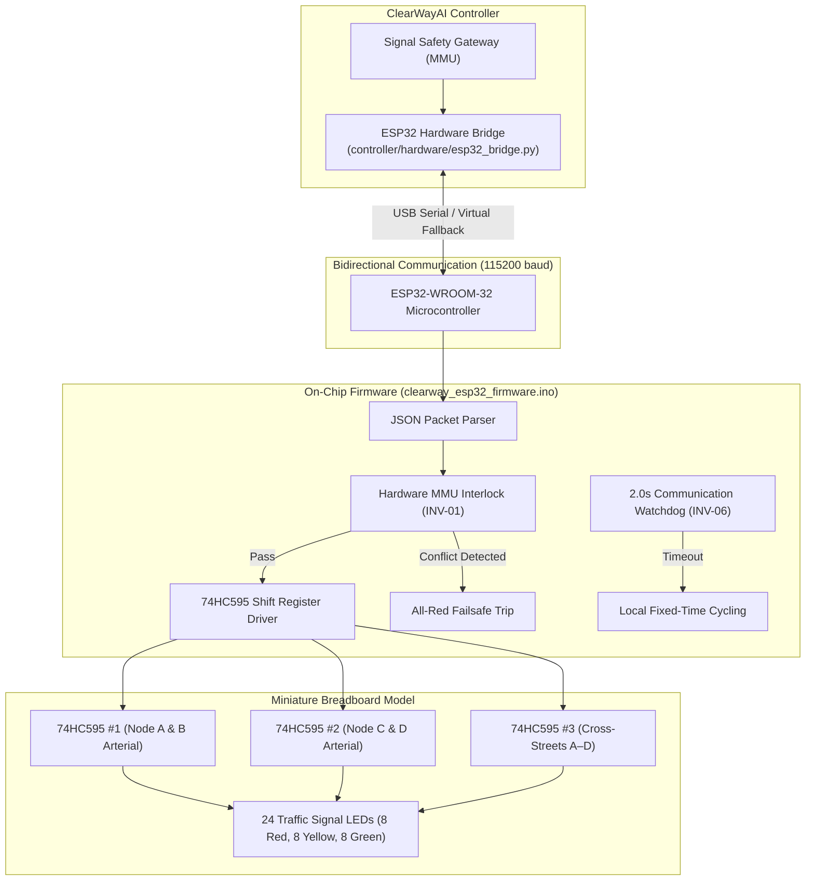

# ClearWayAI Physical Demonstration Bench (`hardware`)

> **Microcontroller Firmware, Shift Register Multiplexing, Hardware-Level MMU Interlock, and Breadboard Schematics for 4-Intersection Physical Testbench (Task 54 VERIFIED)**

[](firmware/clearway_esp32_firmware.ino)
[](schematics/breadboard_wiring.md)
[](bom/BILL_OF_MATERIALS.md)
[](../docs/SAFETY_BOUNDARIES.md)

---

## 1. Directory Structure

```
hardware/
├── firmware/
│   └── clearway_esp32_firmware.ino  # Production C++ Arduino Core sketch (24 channels, MMU, Watchdog)
├── schematics/
│   └── breadboard_wiring.md         # Full pinout, 74HC595 daisy-chain schematic, wiring diagrams
├── bom/
│   └── BILL_OF_MATERIALS.md        # Comprehensive component list, specifications, and cost (~$18.50)
└── README.md
```

---

## 2. System Overview & Architecture

The physical miniature testbench serves as an offline hardware-in-the-loop (HIL) demonstration platform for ClearWayAI, translating digital simulation phase states into physical LED actuations across 4 sequential intersections (Nodes A, B, C, D).



---

## 3. Hardware Specifications & Multiplexing

- **Microcontroller:** ESP32-WROOM-32 (Dual-core Tensilica Xtensa 32-bit LX6 @ 240 MHz).
- **Shift Registers:** 3 daisy-chained `74HC595` 8-bit Serial-In Parallel-Out (SIPO) shift registers providing 24 discrete output channels.
- **GPIO Pinout Allocation:**
  - **DATA (SER):** GPIO 23 (Serial data input to first shift register).
  - **CLOCK (SRCLK):** GPIO 18 (Shift clock pulse on rising edge).
  - **LATCH (RCLK):** GPIO 5 (Output latch register pulse to update all 24 pins simultaneously).
  - **STATUS LED:** GPIO 2 (Heartbeat & communication indicator).
- **Channels Layout:** 4 intersections (Nodes A–D) $\times$ 2 approaches (East-West Arterial & North-South Cross-Street) $\times$ 3 signals (Red, Yellow, Green) = **24 discrete channels**.

---

## 4. Hardware-Level Safety Invariants

### 4.1 Zero-Trust MMU Interlock (INV-01 & INV-03)
The ESP32 firmware enforces a bitmask check on every received phase command before clocking bits to the shift registers. For any node $k \in \{A, B, C, D\}$:
$$\text{Arterial}_{\text{Green/Yellow}} \land \text{Cross}_{\text{Green/Yellow}} \equiv 0$$
If a malformed or malicious packet requests simultaneous green on both approaches, the command is instantly rejected, a `RESP_FAULT` is transmitted over serial, and all intersections trip to `FAILSAFE_ALL_RED`.

### 4.2 Autonomous Watchdog (INV-06)
- **Watchdog Threshold:** $2000\text{ ms}$ ($2.0\text{ s}$).
- **Behavior on Packet Loss:** If communication with the host computer drops for more than $2.0\text{s}$, the ESP32 automatically:
  1. Truncates active green phases safely to Yellow ($3.0\text{ s}$).
  2. Enforces mandatory All-Red clearance ($2.0\text{ s}$).
  3. Drops into local autonomous fixed-time Webster cycling ($72\text{ s}$ cycle) until communication is re-established.

---

## 5. Serial Protocol Specification

- **Baud Rate:** 115200 bps, 8 data bits, no parity, 1 stop bit (8N1).
- **Frame Delimiter:** Newline (`\n`).
- **Command Payloads (Host $\to$ ESP32):**
  ```json
  {"cmd": "SET_PHASES", "nodes": {"nodeA": "GREEN_EW", "nodeB": "RED_EW", "nodeC": "RED_EW", "nodeD": "RED_EW"}, "seq": 104}
  {"cmd": "TEST_PATTERN", "pattern": "GREEN_WAVE"}
  {"cmd": "PING"}
  ```
- **Response Payloads (ESP32 $\to$ Host):**
  ```json
  {"status": "OK", "seq": 104, "watchdog_ms": 15, "state": "NORMAL", "mmu_fault": false}
  {"status": "MMU_TRIP", "seq": 105, "error": "CONFLICT_DETECTED_NODE_A"}
  ```

---

## 6. Software Driver & Virtual Emulator

The host interface is implemented in `controller/hardware/esp32_bridge.py`:
- **Auto-Discovery:** Automatically detects connected ESP32 COM ports (CH340, CP2102, FTDI).
- **Zero-Hardware Fallback (`VirtualESP32Emulator`):** When physical hardware is not plugged in, the system automatically falls back to an in-memory software emulator that faithfully models the 24 channels, MMU bitmasks, and watchdog timers with 100% test compatibility.

### Running Interactive CLI Testbench:
```bash
python controller/hardware/testbench_cli.py --mode sweep
python controller/hardware/testbench_cli.py --mode fault-injection
```

---

## 7. REST API Endpoints

| Method | Endpoint | Description |
| :---: | :--- | :--- |
| `GET` | `/api/v1/hardware/status` | Current connection state, port, watchdog age, and 24-channel LED states |
| `POST` | `/api/v1/hardware/test` | Trigger hardware self-test pattern (`CHASE`, `GREEN_WAVE`, `ALL_RED`, `ALL_YELLOW`) |

---

## 8. Safety & Compliance Notice

> [!IMPORTANT]
> The ClearWayAI physical testbench operates at 5V DC and is completely isolated from municipal roadside traffic signal cabinets. In accordance with [SAFETY_BOUNDARIES.md](../docs/SAFETY_BOUNDARIES.md), this hardware is intended strictly for indoor academic, research, and laboratory demonstration purposes.
