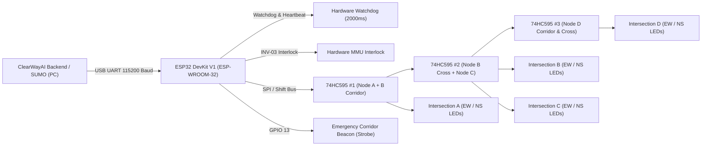

# ClearWayAI Physical Demonstration Bench: Circuit Schematics & Wiring Guide

This document specifies the circuit diagrams, component pinouts, and physical wiring instructions for the 3–4 intersection physical testbench running the ClearWayAI ESP32 hardware firmware (`hardware/firmware/clearway_esp32_firmware.ino`).

---

## 1. System Architecture Overview

The physical bench visualizes traffic signals across 4 consecutive intersections (**Node A, Node B, Node C, Node D**) along the Nguyen Van Linh arterial corridor.

---

## 2. Pinout Assignments

### 2.1 Mode 1: Shift Register Mode (Recommended for 4 Intersections)
Using three daisy-chained **74HC595** 8-bit serial-in/parallel-out shift registers reduces microcontroller pin count to 3 pins while providing 24 independent LED control channels.

| ESP32 GPIO Pin | 74HC595 Pin | Signal Function | Description |
| :--- | :--- | :--- | :--- |
| **GPIO 23** | Pin 14 (DS) | `PIN_SR_DATA` | Serial Data Input |
| **GPIO 22** | Pin 12 (ST_CP) | `PIN_SR_LATCH` | Storage Register Clock (Latch Output) |
| **GPIO 21** | Pin 11 (SH_CP) | `PIN_SR_CLOCK` | Shift Register Clock |
| **GPIO 13** | Direct | `PIN_EMERGENCY_STROBE` | Active-High Emergency Beacon / Siren LED |
| **GPIO 2** | Onboard | `PIN_HEARTBEAT_LED` | Watchdog Status & Keep-alive Indicator |
| **GND** | Pin 8 (GND), 13 (OE) | Ground | Common system ground bus |
| **5V / VIN** | Pin 16 (VCC), 10 (MR)| Power (5V) | Logic supply & LED anode driver |

#### Shift Register Bit Mapping (24 Channels):
- **SR #1 (Bits 0–7):**
  - Bit 0: Node A - North-South Red
  - Bit 1: Node A - North-South Yellow
  - Bit 2: Node A - North-South Green
  - Bit 3: Node A - East-West Red
  - Bit 4: Node A - East-West Yellow
  - Bit 5: Node A - East-West Green
  - Bit 6: Node B - North-South Red
  - Bit 7: Node B - North-South Yellow
- **SR #2 (Bits 8–15):**
  - Bit 8: Node B - North-South Green
  - Bit 9: Node B - East-West Red
  - Bit 10: Node B - East-West Yellow
  - Bit 11: Node B - East-West Green
  - Bit 12: Node C - North-South Red
  - Bit 13: Node C - North-South Yellow
  - Bit 14: Node C - North-South Green
  - Bit 15: Node C - East-West Red
- **SR #3 (Bits 16–23):**
  - Bit 16: Node C - East-West Yellow
  - Bit 17: Node C - East-West Green
  - Bit 18: Node D - North-South Red
  - Bit 19: Node D - North-South Yellow
  - Bit 20: Node D - North-South Green
  - Bit 21: Node D - East-West Red
  - Bit 22: Node D - East-West Yellow
  - Bit 23: Node D - East-West Green

---

### 2.2 Mode 2: Direct GPIO Mode (Miniature 2-Intersection Bench)
For rapid prototype testing without external shift registers:

| Node | Approach | Color | ESP32 GPIO | Resistor |
| :--- | :--- | :--- | :--- | :--- |
| **Node A** | East-West (Corridor) | Red | **GPIO 23** | 220 Ω |
| **Node A** | East-West (Corridor) | Yellow | **GPIO 22** | 220 Ω |
| **Node A** | East-West (Corridor) | Green | **GPIO 21** | 220 Ω |
| **Node A** | North-South (Cross) | Red | **GPIO 19** | 220 Ω |
| **Node A** | North-South (Cross) | Yellow | **GPIO 18** | 220 Ω |
| **Node A** | North-South (Cross) | Green | **GPIO 5** | 220 Ω |
| **Node B** | East-West (Corridor) | Red | **GPIO 17** | 220 Ω |
| **Node B** | East-West (Corridor) | Yellow | **GPIO 16** | 220 Ω |
| **Node B** | East-West (Corridor) | Green | **GPIO 4** | 220 Ω |
| **Node B** | North-South (Cross) | Red | **GPIO 0** | 220 Ω |
| **Node B** | North-South (Cross) | Yellow | **GPIO 2** | 220 Ω |
| **Node B** | North-South (Cross) | Green | **GPIO 15** | 220 Ω |

---

## 3. Electrical Characteristics & Power Budget

- **Supply Voltage:** 5.0 V DC via USB micro-B / Type-C from host laptop or dedicated 5V 2A USB power adapter.
- **Current per LED:** 12 mA – 15 mA (limited by $220\ \Omega$ series resistors at 3.3V / 5V).
- **Max Active LEDs:**
  - Standard state: 4 nodes $\times$ 2 heads active $\times$ 1 LED per head = 8 LEDs active $\approx 120\text{ mA}$.
  - Lamp Test (All LEDs on): 24 LEDs $\approx 360\text{ mA}$.
- **ESP32 DevKit draw:** $\approx 80\text{ mA}$ (Wi-Fi/Bluetooth inactive, serial UART only).
- **Total Power Consumption:** $\le 450\text{ mA}$ at 5V ($\approx 2.25\text{ W}$), comfortably supported by any standard USB 2.0 / 3.0 port (500mA - 900mA).

---

## 4. Hardware Safety Rules

1. **Common Ground:** All GND pins from the ESP32, shift registers, and LED modules must be securely tied to the common ground rail of the breadboard.
2. **Current Limiting:** Never connect traffic light LEDs directly to 5V or ESP32 GPIOs without series current-limiting resistors ($220\ \Omega \dots 330\ \Omega$).
3. **Decoupling Capacitors:** Place one $0.1\ \mu\text{F}$ ceramic capacitor between Pin 16 (VCC) and Pin 8 (GND) of each 74HC595 shift register to suppress switching noise.
4. **INV-06 Watchdog:** If the host PC fails or crashes, the ESP32 onboard timer drops to autonomous cycling within 2000 ms, keeping physical signals safe.

