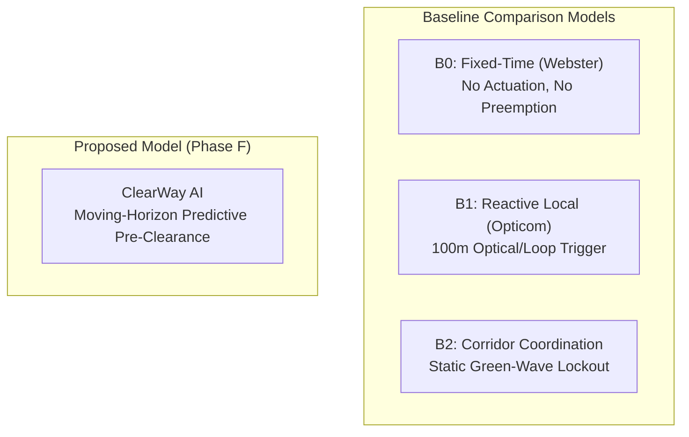

# ClearWayAI - Baseline Signal Controllers & Benchmark Protocols (`simulation/baselines`)

> **Standardized Baseline Traffic Signal Controllers (B0, B1, B2) for Fair Empirical Benchmarking**

---

## 1. Overview

To scientifically validate the efficacy of ClearWayAI's moving-horizon predictive pre-clearance algorithm (Phase F), this module provides **three standardized baseline controllers** implemented under identical simulation conditions, network geometry, demand patterns, and random seeds.



---

## 2. Baseline Controllers Specification

### Baseline B0: Fixed-Time Signal Control (`b0_fixed_time.py`)
- **Theory:** Standard pre-timed Webster signal timing based on historical arrival counts.
- **Cycle Time:** $72\text{ s}$ fixed cycle (EB/WB Green: $35\text{ s}$, Yellow: $4\text{ s}$, All-Red: $2\text{ s}$, NB/SB Green: $25\text{ s}$, Yellow: $4\text{ s}$, All-Red: $2\text{ s}$).
- **Priority Logic:** **None.** Emergency vehicles must queue behind standard traffic and obey red lights.
- **Role:** Pure negative control baseline representing uncoordinated, non-prioritized urban arteries.

### Baseline B1: Reactive Local Preemption (`b1_reactive.py`)
- **Theory:** Traditional localized optical/strobe preemption (e.g., 3M Opticom, Priority One).
- **Trigger:** Proximity detector activates when an emergency vehicle is detected $100\text{ m}$ upstream of an intersection stopline ($X_i - 100\text{ m} \le X_{\text{EV}} \le X_i + 15\text{ m}$).
- **Behavior:** Forces early transition of cross-streets to yellow ($4\text{ s}$) $\to$ all-red ($2\text{ s}$) $\to$ Emergency Arterial Green ($35\text{ s}$).
- **Drawbacks:**
  - Localized with zero corridor-wide foresight: downstream queues are not drained in advance.
  - Abrupt phase truncation creates secondary shockwaves on cross-streets.

### Baseline B2: Corridor Coordination Green-Wave (`b2_corridor.py`)
- **Theory:** Traditional arterial green-wave corridor lockout.
- **Trigger:** Activates when an emergency vehicle enters the western corridor gate ($X_{\text{EV}} \ge -150\text{ m}$).
- **Behavior:** All 4 intersections along the arterial (Nodes A–D) are locked to Arterial Green for the entire duration of the transit ($> 50\text{ s}$).
- **Drawbacks:**
  - Prolonged red lock on cross-streets causes massive secondary delays and queue spillback.
  - Standing queues are not actively cleared before ambulance arrival, leading to congestion blockades.

---

## 3. Comparison Matrix: Baselines vs ClearWay AI

| Strategy | Corridor Foresight | Queue Drainage | Cross-Street Delay | Post-Clearance Recovery |
| :--- | :---: | :---: | :---: | :---: |
| **B0 (Fixed-Time)** | ❌ None | ❌ None | Low | Nominal |
| **B1 (Reactive Local)** | ❌ Isolated ($100\text{ m}$) | ❌ None | Moderate | ❌ Abrupt return |
| **B2 (Corridor Coordination)** | ⚠️ Static Green-Wave | ❌ None | 🔴 **High ($> 45\text{ s}$)** | ❌ Prolonged desync |
| **ClearWay AI (Proposed)** | ✅ **Moving-Horizon (Nodes A–D)** | ✅ **Predictive Pre-Clearance** | 🟢 **Low ($-19\%$)** | ✅ **Smooth Equilibrium** |

---

## 4. Running Comparative Benchmarks

```bash
# Run 90-second benchmark comparison across all 3 baselines
python simulation/baselines/benchmark_runner.py --scenario peak_emergency --duration 90

# Export results to JSON
python simulation/baselines/benchmark_runner.py --scenario peak_emergency --duration 90 --export simulation/baselines/results/peak_benchmark.json
```
