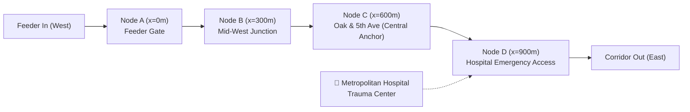

# ClearWayAI - SUMO 4-Node Arterial Corridor Network (`simulation/sumo`)

> **Synthetic Multi-Intersection Arterial Network Specification & Geometrical Model**

---

## 1. Network Overview

The ClearWayAI arterial corridor models a critical urban multi-intersection artery (Oak–5th Avenue corridor) comprising **4 sequential signalized intersections** (Nodes A–D) connecting western feeder traffic to the Metropolitan Hospital medical trauma center at Node D.



---

## 2. Geometric Specification & Cross-Sections

### Arterial Corridor (Eastbound & Westbound)
- **Segment Length:** $300\text{ m}$ between adjacent intersections ($900\text{ m}$ corridor distance, $1300\text{ m}$ total arterial length including feeders).
- **Lanes:** 3 lanes per direction ($3.2\text{ m}$ width per lane, $9.6\text{ m}$ directional cross-section).
  - **Lane 0 (Rightmost):** Through movement & Right-turn slip.
  - **Lane 1 (Center):** Direct Through movement ($16.67\text{ m/s} = 60\text{ km/h}$).
  - **Lane 2 (Leftmost):** Through movement & Dedicated Left-turn pocket.
- **Speed Limit:** $60\text{ km/h}$ ($16.67\text{ m/s}$).

### Cross Streets (Northbound & Southbound)
- **Approach Length:** $200\text{ m}$ north and south from arterial centerline.
- **Lanes:** 2 lanes per direction ($3.2\text{ m}$ width, $6.4\text{ m}$ directional cross-section).
  - **Lane 0 (Right):** Through & Right-turn.
  - **Lane 1 (Left):** Through & Left-turn.
- **Speed Limit:** $50\text{ km/h}$ ($13.89\text{ m/s}$).

---

## 3. Sublane Model Configuration (ADR-0005)

In accordance with [ADR-0005](../../docs/adr/0005-mixed-motorcycle-sublane-model.md), the corridor enables SUMO's microscopic Sublane Model:
- **Lateral Resolution:** $0.64\text{ m}$ (divides each $3.2\text{ m}$ physical lane into up to 5 lateral sublanes).
- **Simulation Time Step:** $\Delta t = 0.1\text{ s}$ ($10\text{ Hz}$ physics simulation frequency).
- **Motorcycle Dynamics:** Lateral alignment `arbitrary`, lateral gap $0.2\text{ m}$, enabling realistic lane splitting, filtering between queued automobiles, and stopline swarming characteristic of Vietnamese urban traffic.

---

## 4. Traffic Signal Logics (NEMA Standard)

All 4 intersections feature dual signal programs conforming strictly to [SAFETY_BOUNDARIES.md](../../docs/SAFETY_BOUNDARIES.md):

### Program 0: Nominal Fixed-Time / Actuated
| Phase | Movement | Duration | Safety Invariant |
| :---: | :--- | :---: | :--- |
| **0** | Arterial Green (EB & WB) | $35\text{ s}$ | Min-green $\ge 10\text{ s}$, Max-green $\le 65\text{ s}$ |
| **1** | Arterial Yellow | $4\text{ s}$ | Yellow interval $\ge 3\text{ s}$ |
| **2** | All-Red Clearance | $2\text{ s}$ | Clearance interval $\ge 2\text{ s}$ |
| **3** | Cross-Street Green (NB & SB) | $25\text{ s}$ | Min-green $\ge 10\text{ s}$, Max-green $\le 45\text{ s}$ |
| **4** | Cross-Street Yellow | $4\text{ s}$ | Yellow interval $\ge 3\text{ s}$ |
| **5** | All-Red Clearance | $2\text{ s}$ | Clearance interval $\ge 2\text{ s}$ |
- **Nominal Cycle Time:** $C = 35 + 4 + 2 + 25 + 4 + 2 = 72\text{ s}$.

### Program `preemption`: Emergency Corridor Wave
- Dedicated green extension along the Eastbound corridor route toward Metropolitan Hospital ($50\text{ s}$ green, all conflicting movements held at red).

---

## 5. Surveillance & Detector Network (`corridor_4node.det.xml`)

Every approaching lane is instrumented with synthetic inductive and areal detectors:
- **E1 Stopline Detectors (`pos = length - 5.0m`):** Measure exact arrival counts, headways, and instantaneous passage speed.
- **E1 Advance Detectors (`pos = length - 80.0m`):** Upstream telemetry to predict vehicle arrivals $5\text{ s}$ before stopline.
- **E2 Lane Area Detectors (`length = 70.0m`):** Measure continuous spatial queue length (`jamLengthInMeters`), density, and mean approach speed for ClearWay AI clearance time prediction (Phase E).

---

## 6. Network Files & Generation

```bash
# Build or rebuild all network definitions
python simulation/sumo/build_network.py
```

Generated files:
- `corridor_4node.nod.xml`: Node coordinates and junction types.
- `corridor_4node.edg.xml`: Edge parameters, lane counts, speed limits.
- `corridor_4node.con.xml`: Lane turn movement allowances and right-of-way.
- `corridor_4node.tll.xml`: Traffic light programs and conflict-free phase definitions.
- `corridor_4node.det.xml`: E1 and E2 detector layouts.
- `corridor_4node.sumocfg`: Master SUMO configuration file.
- `corridor_4node.net.xml`: Compiled, valid SUMO network XML verified via `sumolib`.

