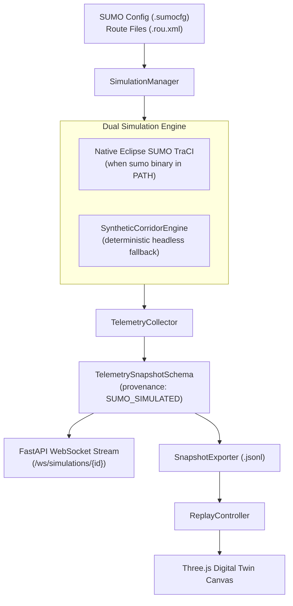

# ClearWayAI - SUMO / TraCI Simulation Adapter (`simulation/traci`)

> **Microscopic Traffic Simulation Adapter, State Extraction, Replay Controller, and Telemetry Exporter**

---

## 1. Overview & Architecture

The `simulation/traci` module provides the real-time simulation bridge between the microscopic traffic environment and the ClearWayAI digital twin ecosystem. It handles simulation stepping, state extraction, atomic telemetry serialization, and deterministic recording/replay.



---

## 2. Key Components

### 1. `SimulationManager` (`manager.py`)
- **Lifecycle API:** `start()`, `step(dt=0.1)`, `pause()`, `resume()`, `stop()`.
- **Dual Engine Architecture:**
  - Automatically detects whether the native `sumo` C++ binary is installed in system PATH.
  - When SUMO is absent, seamlessly falls back to `SyntheticCorridorEngine`, providing deterministic vehicle physics, sublane lateral filtering, and NEMA signal cycling with zero external dependencies.
- **Atomic Telemetry Output:** Emits fully typed `TelemetrySnapshotSchema` instances conforming to `apps/api/src/schemas.py`.

### 2. `TelemetryCollector` (`telemetry_collector.py`)
- Maps microscopic coordinates, heading angles, speeds, and lane IDs to 3D Cartesian coordinates.
- Aggregates signal states across the Oak–5th corridor (intersections A–D).
- Calculates real-time corridor KPIs: average speed, queue length ($m$), occupancy ($pct$), and emergency ETA ($min$).

### 3. `SnapshotExporter` (`snapshot_exporter.py`)
- Serializes telemetry snapshots into high-performance Line-Delimited JSON (`.jsonl`).
- Generates simulation run summaries (total duration, peak vehicle count, average speeds, emergency transit time).

### 4. `ReplayController` (`replay_controller.py`)
- Provides deterministic, frame-accurate playback of recorded simulation runs.
- Features: `play()`, `pause()`, `toggle()`, `seek(time_sec)`, `step_forward()`, `step_backward()`, and variable speed control ($0.5\times$, $1.0\times$, $2.0\times$, $4.0\times$).

---

## 3. CLI Usage & Headless Simulation Runs

```bash
# Run a 30-second headless simulation and export to JSONL
python simulation/traci/run_simulation.py --scenario peak_emergency --duration 30 --export simulation/traci/logs/peak_30s.jsonl

# Run a quick 10-second test
python simulation/traci/run_simulation.py --scenario normal --duration 10
```

---

## 4. Python API Example

```python
from pathlib import Path
from simulation.traci.manager import SimulationManager
from simulation.traci.snapshot_exporter import SnapshotExporter
from simulation.traci.replay_controller import ReplayController

# 1. Initialize and run simulation
mgr = SimulationManager(config_path="simulation/scenarios/corridor_peak_emergency.sumocfg")
mgr.start()

snapshots = []
for _ in range(100):  # 10.0 seconds at dt=0.1s
    snap = mgr.step(dt=0.1)
    snapshots.append(snap)
mgr.stop()

# 2. Export snapshots to JSONL
SnapshotExporter.export_jsonl(snapshots, "simulation/traci/logs/session.jsonl")

# 3. Load into ReplayController
replay = ReplayController()
replay.load_log("simulation/traci/logs/session.jsonl")
replay.seek(5.0)  # Jump to t=5.0s
current_snap = replay.get_current_snapshot()
```

